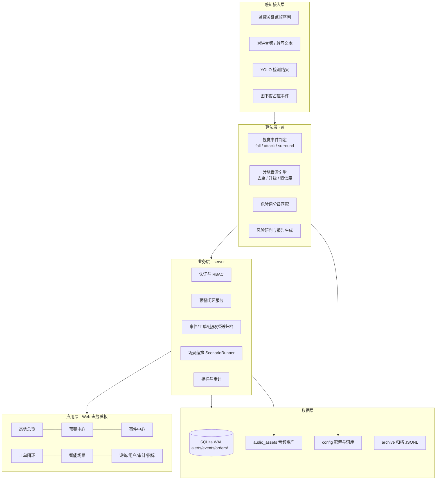
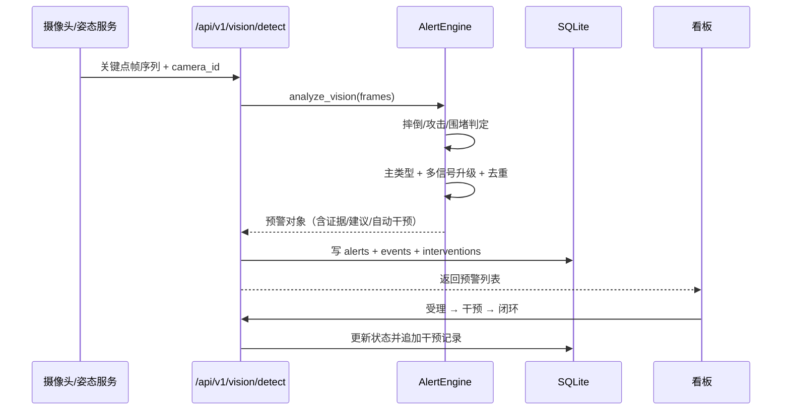
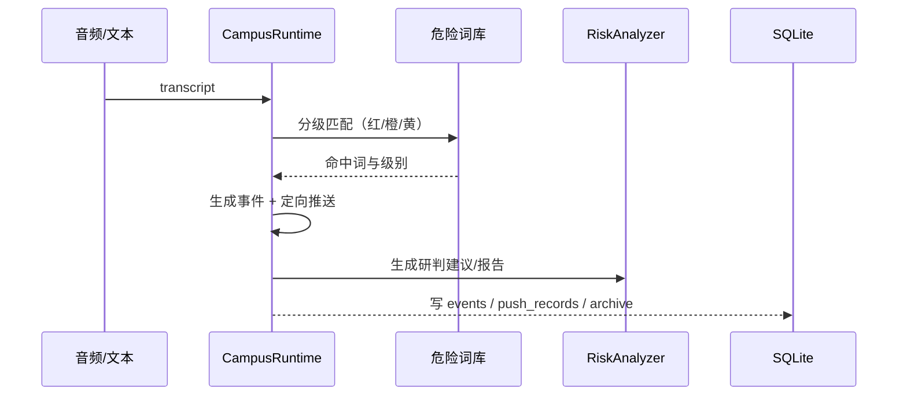
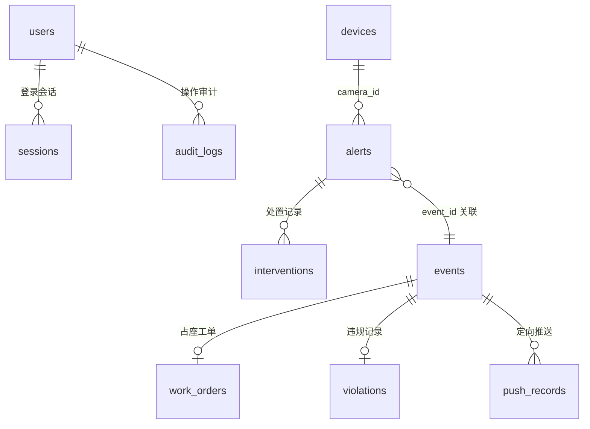
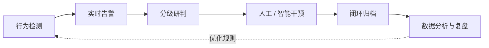
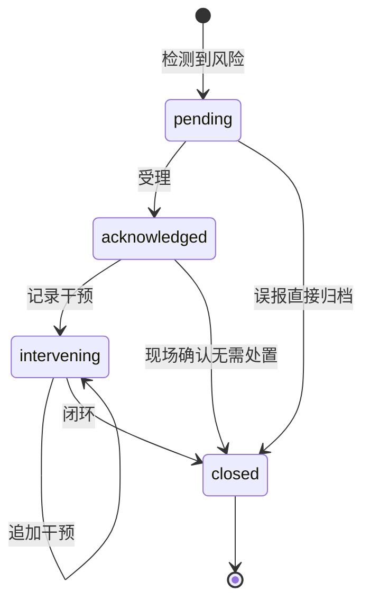
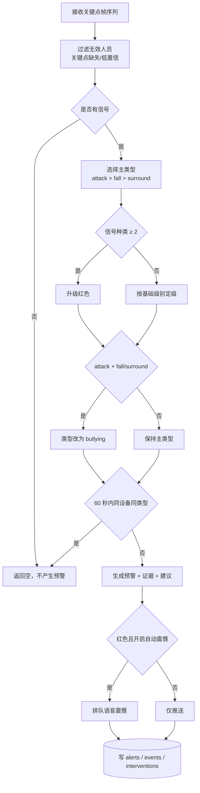
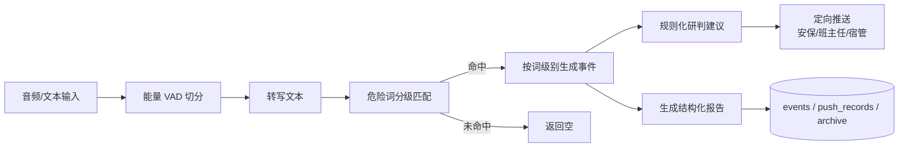
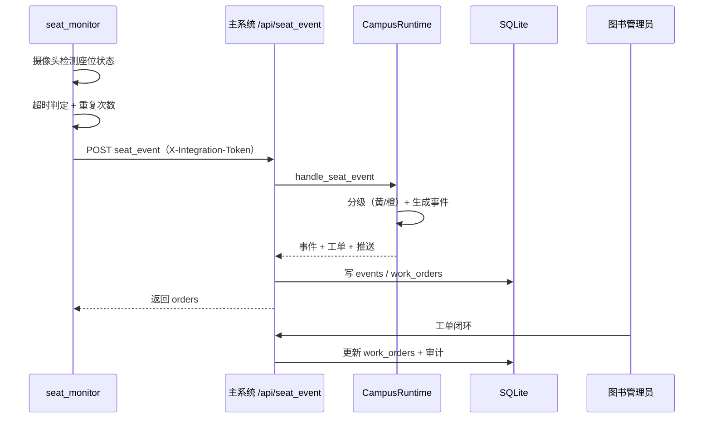
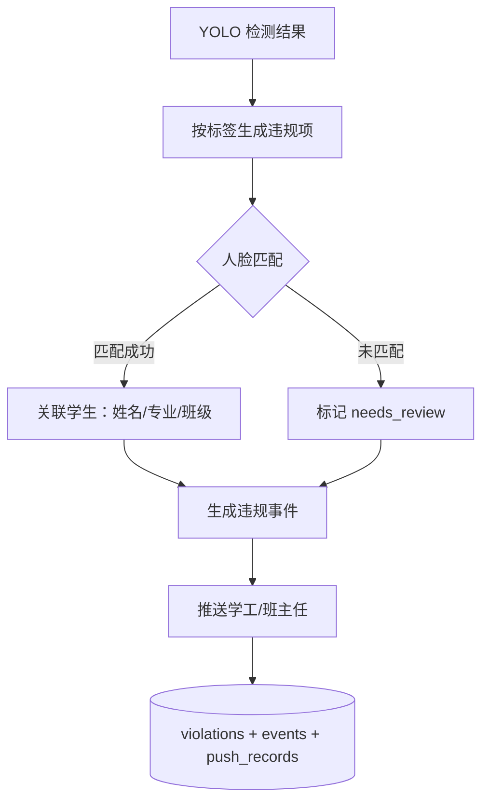

# 01 系统总体方案

> 数智卫校 · 校园安全 AI 预警与干预系统
> 基于 AI + 大数据的智慧校园防霸凌平台
> 本文档由原文档 01–08（系统概述与建设目标、总体架构设计、功能模块说明、业务流程与闭环设计、AI 算法与预警规则、API 接口规范、部署与运维手册、测试与验收报告）整合而成 · v2.1.0

---

## 一、系统概述与建设目标

### 1. 建设背景

中职、高职校园普遍存在以下安全治理难点：

| 痛点 | 现状 | 后果 |
| --- | --- | --- |
| 监控只能"看"不能"懂" | 摄像头数量多，依赖人工盯屏 | 夜间、楼道、操场角落等盲区事件发现滞后 |
| 霸凌行为隐蔽 | 围堵、推搡、言语威胁持续时间短 | 事后取证困难，学生不敢主动报告 |
| 处置链路割裂 | 发现、上报、调度、处置分散在不同系统 | 响应慢、责任不清、无完整留痕 |
| 数据无法沉淀 | 事件停留在纸质记录或聊天工具 | 无法做趋势分析、无法支撑德育决策 |

本系统在旧版「校园安全 AI 预警与干预系统」与图书馆占座监测项目的基础上整合重构，
将**计算机视觉行为识别、语音危险词研判、分级预警、干预处置、闭环归档**收敛到同一套技术底座，
形成面向数智卫校的校园安全数字化治理平台。

### 2. 系统定位

> 依托计算机视觉算法对校园监控画面进行实时智能分析，精准识别霸凌行为、聚集冲突等各类校园危险事件，
> 自动触发分级预警机制，完整留存全流程事件记录，构建从**行为检测 → 实时告警 → 人工/智能干预**的完整业务闭环。

系统的三个核心特征：

1. **能识别**：基于 COCO-17 人体姿态关键点，判断摔倒、攻击、围堵三类风险信号，并支持多信号叠加升级为「疑似校园霸凌」。
2. **能闭环**：每条预警都有唯一编号，串起事件、推送、工单、干预、审计六类记录，做到"一事一档、全程可溯"。
3. **能落地**：标准库优先、单机一键启动、无外网 CDN；YOLO / ASR / LLM 均以适配器方式接入，缺少依赖时自动降级为离线演示，不影响系统运行。

### 3. 建设目标

#### 3.1 业务目标

- **发现更早**：危险行为从发生到产生预警控制在秒级窗口内；
- **判断更准**：单一信号不误报升级，多信号叠加才判定霸凌，降低误报干扰；
- **处置更快**：红色预警自动下发语音震慑，并按级别定向推送安保负责人、值班领导、班主任；
- **留痕更全**：预警受理、干预、闭环全过程写入数据库与审计日志，支持报告导出；
- **治理更实**：按区域、类型、级别统计趋势，为校园安全例会与德育管理提供数据支撑。

#### 3.2 技术目标

| 目标 | 落地方式 |
| --- | --- |
| 统一技术栈 | FastAPI + SQLite + 原生 HTML/CSS/JS，标准库优先 |
| 低部署门槛 | `python -m server.main` 或 `start.bat` 一键启动，无需外部中间件 |
| 算法可替换 | 姿态判定为纯函数；YOLO / ASR / LLM 通过适配器接入，可离线降级 |
| 数据可迁移 | SQLite（WAL）开发部署，表结构兼容 MySQL / PostgreSQL 平移 |
| 安全合规 | PBKDF2 密码哈希、会话 Token、RBAC 权限点、登录失败锁定、全量审计 |

### 4. 系统范围

#### 4.1 本期范围

- 校园危险行为视觉识别：摔倒、攻击、围堵、霸凌冲突；
- 分级预警：红 / 橙 / 黄 / 蓝四级，支持去重与多信号升级；
- 干预闭环：受理、语音震慑、安保调度、班主任通知、现场处置、闭环归档；
- 多模态研判：音频转写、危险词分级匹配、规则化 LLM 深判与结构化报告；
- 统一态势看板：总览、预警中心、事件中心、工单闭环、智能场景、设备、用户权限、审计、指标；
- 扩展场景：图书馆超时占座工单、行为规范违规识别与人脸定位。

#### 4.2 不在本期范围

- 真实摄像头 RTSP 流的规模化接入与 GPU 集群调度（保留 `seat_monitor` 作为单路真实接入样例）；
- 与教育局、公安平台的跨系统级联（预留 REST 接口与事件编号规范）；
- 移动端 App（当前看板为响应式 Web，可在移动浏览器使用）。

### 5. 用户与角色

| 角色 | 标识 | 典型用户 | 核心权限 |
| --- | --- | --- | --- |
| 系统管理员 | `admin` | 信息中心 | 全部权限，含用户与设备管理 |
| 安保负责人 | `security_leader` | 保卫处 | 预警处置、场景运行、审计、指标 |
| 安保值班员 | `security_staff` | 值班室 | 预警处置、场景运行、设备查看 |
| 班主任 | `head_teacher` | 学生管理 | 预警查看、事件、违规、推送 |
| 演示访客 | `viewer` | 参观/评审 | 仅事件查看（敏感字段脱敏） |

权限以「权限点」而非角色硬编码，新增角色只需在 `server/core/auth.py` 的 `ROLE_PERMISSIONS` 中组合权限点；权限点完整定义见第三章第 7 节。

### 6. 核心价值

1. **安全价值**：把"事后追责"前移为"事中干预"，红色预警平均处置链路可压缩到分钟级。
2. **管理价值**：霸凌、冲突、摔倒、占座、行为规范五类事件统一归档，形成校园安全数据资产。
3. **技术价值**：算法层与业务层解耦，姿态判定零依赖可测试，视觉模型可按学校实际硬件替换。
4. **合规价值**：最小权限、审计留痕、敏感字段脱敏，满足《个人信息保护法》《未成年人保护法》对校园场景的基本要求。

### 7. 合规与隐私

- 人脸匹配仅用于校内安全事件定位，演示数据全部为虚构；
- `viewer` 角色访问事件列表时不返回事件详情字段；
- 审计日志记录登录、预警处置、场景运行、设备与用户变更等关键操作；
- 真实部署应设置监控数据保留期限、访问审批流程，并告知师生监控范围与用途；
- 建议生产环境立即修改预置账号密码，并关闭演示账号。

---

## 二、总体架构设计

### 1. 设计原则

| 原则 | 说明 |
| --- | --- |
| 分层解耦 | 感知层、算法层、业务层、应用层、数据层职责单一，层间通过数据结构通信 |
| 标准库优先 | 除 FastAPI / Uvicorn 外不强制第三方依赖，降低学校部署与运维成本 |
| 可插拔降级 | YOLO 权重、ASR、LLM 均为可选增强，缺失时自动使用离线模拟，不阻断主流程 |
| 一事一档 | 预警编号 `ALM-*` 与事件编号 `EVT-*` 贯穿全链路，支持正反向追溯 |
| 安全默认 | 默认拒绝未授权访问，权限点粒度控制，敏感字段按角色脱敏 |

### 2. 分层架构



#### 2.1 感知层

| 输入 | 格式 | 来源 |
| --- | --- | --- |
| 姿态关键点帧序列 | `frames: [[{person...}]]`，COCO-17 | 摄像头 + 姿态估计模型 |
| 音频 / 转写文本 | WAV 或文本 | 对讲设备、ASR 服务 |
| 目标检测结果 | `label/conf/bbox/face_ref` | YOLO 行为规范模型 |
| 占座事件 | `seat_id/absent_minutes/items` | `seat_monitor` 独立服务 |

#### 2.2 算法层

- `ai/vision/events.py`：纯函数算法，无 I/O、无第三方依赖，可直接单元测试；
- `ai/vision/service.py`：把一帧序列标准化后输出 `VisionSignal` 列表；
- `ai/alert_engine.py`：信号 → 预警，负责主类型选择、升级、去重、置信度、证据与自动干预；
- `ai/audio/`：能量 VAD 与危险词分级匹配；
- `ai/llm/analyzer.py`：规则化处置建议与 Markdown 报告（LLM 深判由 `campus_ai/agent_service` 的 OllamaClient 承担）。

#### 2.3 业务层

- `server/api.py`：全部 REST 接口，统一响应 `{"code":0,"data":...}`；
- `server/core/auth.py`：PBKDF2 哈希、会话 Token、RBAC 权限点；
- `server/core/db.py`：连接、建表、种子数据与业务写入；
- `server/core/metrics.py`：线程安全运行指标；
- `server/core/config.py`：默认配置 + `config/app.json` 深合并，路径统一相对项目根目录。

#### 2.4 应用层

`web/index.html` 单文件看板：原生 HTML/CSS/JS，纯 SVG 图表，无外网 CDN，
登录后按角色渲染导航，覆盖总览、预警、事件、工单、场景、设备、用户、审计、指标九个页面。

#### 2.5 数据层

- SQLite（WAL 模式）存储业务数据，默认路径 `data/campus_security.db`；
- `config/` 存放应用配置与危险词库；
- `audio_assets/` 存放真实语音样本与对应转写文本；
- `archive/` 由 `campus_ai` 运行时写入 JSONL 归档（推送、报告、工单）。

### 3. 关键运行链路

#### 3.1 视觉预警链路



#### 3.2 多模态研判链路



### 4. 技术栈

| 层 | 技术 | 说明 |
| --- | --- | --- |
| Web 框架 | FastAPI + Uvicorn | 自动 OpenAPI 文档 `/api/docs` |
| 数据库 | SQLite（WAL） | 零部署；表结构可平移 MySQL/PostgreSQL |
| 认证 | PBKDF2-HMAC-SHA256 + Bearer Token | 10 万次迭代，会话 8 小时 |
| 前端 | 原生 HTML/CSS/JS + SVG | 单文件、无 CDN、响应式 |
| 视觉算法 | COCO-17 关键点几何判定 | 零依赖，可测试 |
| 语音 | 能量 VAD + 危险词分级匹配 | 标准库 `array` 实现 |
| 大模型 | 规则化研判 + 可选 Ollama | 异常静默降级 |
| 测试 | pytest + Uvicorn 线程 + urllib | 不依赖 httpx/TestClient |

### 5. 目录与职责

```text
server/          统一后端：API、认证、数据库、指标
ai/              AI 感知与告警：vision、audio、llm、alert_engine
campus_ai/       可复用 AI 业务运行时：agent/intercom/behavior/seat
demo/            演示场景与姿态数据构造
web/             统一态势看板
seat_monitor/    图书馆占座真实摄像头扩展服务
config/          应用配置、危险词库
audio_assets/    真实语音样本与转写
docs/            标准化项目文档
ppt/             PPTX 与 HTML 演示稿
tests/           单元测试与集成测试
```

### 6. 数据模型



核心表：

| 表 | 作用 | 关键字段 |
| --- | --- | --- |
| `users` / `sessions` | 账号与会话 | `password_hash`、`role`、`expires_at` |
| `alerts` | 预警主表 | `alert_id`、`severity`、`status`、`evidence` |
| `interventions` | 干预时间线 | `kind`（voice/dispatch/notify/onsite/close） |
| `events` | 统一事件归档 | `event_type`、`detail` |
| `work_orders` | 占座工单 | `seat_id`、`status` |
| `violations` | 行为规范违规 | `label`、`student_id`、`needs_review` |
| `push_records` | 定向推送 | `targets`、`severity` |
| `devices` | 设备台账 | `dtype`、`location`、`status` |
| `audit_logs` | 审计日志 | `username`、`action` |

### 7. 扩展性与演进

- **新增识别类型**：在 `ai/vision/events.py` 增加判定函数，在 `ai/alert_engine.py` 注册类型、基础级别与标签即可；
- **新增业务场景**：实现 `CampusRuntime` 中对应 `handle_*`，并在 `demo/scenarios.py` 注册场景；
- **替换视觉模型**：保持帧序列输入契约不变，可替换为 YOLO-Pose、RTMPose 等；
- **生产数据库**：将 `server/core/db.py` 的连接层替换为 SQLAlchemy/psycopg，表结构与 SQL 基本兼容；
- **多校区部署**：看板与 API 前后端分离后可直接水平扩展，SQLite 换成集中式数据库。

---

## 三、功能模块说明

### 1. 功能地图

```text
数智卫校 · 校园安全 AI 预警与干预系统
├─ 态势总览
├─ 预警中心（视觉 / 语音 / 全类型）
├─ 事件中心
├─ 工单闭环（图书馆占座扩展）
├─ 智能场景（8 个可运行演示）
├─ 设备管理
├─ 用户与权限
├─ 审计日志
├─ 运行指标
└─ 基础能力：认证 / RBAC / 配置 / 指标 / 归档
```

### 2. 页面级模块

#### 2.1 态势总览

| 项 | 说明 |
| --- | --- |
| 指标卡 | 累计预警、今日预警、待处置、红色未闭环、干预次数、今日事件、待处理工单、在线设备 |
| 24 小时趋势 | 纯 SVG 折线图，按小时聚合预警数量 |
| 级别分布 | 红 / 橙 / 黄 / 蓝四色占比 |
| 类型分布 | 霸凌、攻击、摔倒、围堵、危险言语、占座、行为违规 |
| 摄像头卡片 | 每路设备的在线状态、今日预警数、最近预警时间 |
| 最新预警 | 最近 6 条，点击进入详情 |

接口：`GET /api/v1/overview`，权限 `event.view`。

#### 2.2 预警中心

- 多条件筛选：状态、级别、类型、摄像头、关键词；
- 预警详情：基础信息、证据（信号、指标、姿态骨架 SVG）、处置建议、干预时间线、研判报告；
- 闭环操作：受理 → 记录干预（语音/调度/通知/现场）→ 闭环归档。

接口：`GET /api/v1/alerts`、`GET /api/v1/alerts/{id}`、`POST .../ack`、`POST .../intervene`、`POST .../close`。

#### 2.3 事件中心

- 统一展示 `alert / work_order / violation / report / deterrence` 事件；
- 支持按事件类型与级别筛选；
- `viewer` 角色不返回 `detail` 明细，实现最小披露。

接口：`GET /api/v1/events`，权限 `event.view`。

#### 2.4 工单闭环

- 展示图书馆占座工单：座位号、区域、状态、创建时间、闭环人；
- 支持一键闭环，写入审计日志。

接口：`GET /api/v1/orders`、`POST /api/v1/orders/{event_id}/close`。

#### 2.5 智能场景

提供 8 个可重复运行的场景，覆盖视觉感知、AI 业务与扩展场景：

| 场景 | 名称 | 预期结果 |
| --- | --- | --- |
| `vision_attack` | 视觉预警 · 暴力攻击 | 红色预警 + 自动语音震慑 |
| `vision_fall` | 视觉预警 · 人员摔倒 | 橙色预警 + 校医/班主任通知建议 |
| `vision_surround` | 视觉预警 · 多人围堵 | 黄色预警 |
| `vision_bullying` | 视觉预警 · 霸凌冲突 | 围堵 + 攻击叠加，升级红色 |
| `agent` | 智能体 · 多模态研判 | 音频转写、研判、结构化报告、定向推送 |
| `intercom` | 对讲 · 危险词干预 | 命中危险词告警并播放制止话术 |
| `behavior` | 行为规范 · 人脸定位 | 违规检出、学生定位、未识别转人工 |
| `seat` | 图书馆 · 占座工单 | 超时占座生成工单并推送管理员 |

接口：`GET /api/v1/scenarios`、`POST /api/v1/scenarios/{name}`，权限 `scenario.run`。

#### 2.6 设备管理

- 设备台账：摄像头、对讲、告警器；
- 展示在线状态、所属区域；
- 管理员可新增设备（编号、类型、位置）。

接口：`GET /api/v1/devices`、`POST /api/v1/devices`。

#### 2.7 用户与权限

- 展示账号、姓名、角色、启用状态（角色定义见第一章第 5 节）；
- 管理员可创建账号并分配角色。

接口：`GET /api/v1/users`、`POST /api/v1/users`，权限 `user.manage`。

#### 2.8 审计日志

- 记录登录、登出、预警受理/干预/闭环、场景运行、设备与用户变更、占座事件接入；
- 展示操作人、动作、对象、时间。

接口：`GET /api/v1/audit`，权限 `audit.view`。

#### 2.9 运行指标

- 进程运行时长、接口调用计数、登录成功/失败、预警各动作计数；
- 数据库侧统计：预警、事件、待处理工单、违规、推送、干预数量。

接口：`GET /api/v1/metrics`，权限 `metrics.view`。

### 3. 后端服务模块

| 模块 | 文件 | 职责 |
| --- | --- | --- |
| 应用工厂 | `server/api.py` | 创建 FastAPI 实例、注册路由、静态挂载、异常映射 |
| 启动入口 | `server/main.py` | 参数解析、Uvicorn 启动 |
| 配置 | `server/core/config.py` | 默认值、深合并、路径解析 |
| 数据库 | `server/core/db.py` | 建表、种子、统一写入 |
| 认证 | `server/core/auth.py` | 密码哈希、会话、RBAC |
| 指标 | `server/core/metrics.py` | 线程安全计数器 |
| 表结构 | `server/sql/schema.sql` | 10 张业务表与索引 |

### 4. AI 模块

| 模块 | 文件 | 职责 | 输入 → 输出 |
| --- | --- | --- | --- |
| 视觉事件 | `ai/vision/events.py` | 摔倒、攻击、围堵几何判定 | 关键点 → `Detection` |
| 窗口分析 | `ai/vision/service.py` | 帧序列标准化与信号汇总 | `frames` → `VisionSignal[]` |
| 告警引擎 | `ai/alert_engine.py` | 分级、升级、去重、置信度、证据 | 信号 → 预警对象 |
| 语音 VAD | `ai/audio/vad.py` | 能量端点检测 | PCM → 语音段 |
| 危险词 | `ai/audio/danger_words.py` | 红/橙/黄词库匹配 | 文本 → `MatchResult` |
| 风险研判 | `ai/llm/analyzer.py` | 处置建议与 Markdown 报告 | 预警 → 建议/报告 |

### 5. 可复用业务运行时（campus_ai）

| 服务 | 职责 | 统一出口 |
| --- | --- | --- |
| `agent_service` | 多模态输入 → 结构化事件 + 报告 + 推送 | `handle_media` |
| `intercom_service` | 收音 → 危险词 → 口头制止 | `handle_utterance` |
| `behavior_service` | 检测 → 人脸匹配 → 违规事件 | `ingest_behavior` |
| `seat_service` | 占座事件 → 分级 → 工单 | `handle_seat_event` |
| `runtime.py` | 统一编排、归档、统计 | `CampusRuntime` |

### 6. 扩展服务（seat_monitor）

| 模块 | 职责 |
| --- | --- |
| `capture.py` | 摄像头取流 |
| `detector.py` / `inference.py` | YOLO 检测与权重降级 |
| `seat_state.py` / `state_engine.py` | 座位在座/离座状态机 |
| `reservation.py` / `roi_store.py` | 预约数据与座位 ROI 标定 |
| `agent_client.py` | 带 `X-Integration-Token` 推送主系统 |
| `pipeline.py` | 单路流水线编排 |
| `api.py` / `main.py` | 本地服务与启动入口 |

### 7. 权限点与页面可见性

| 权限点 | 说明 | 关联页面 |
| --- | --- | --- |
| `alert.view` | 查看预警 | 预警中心、总览 |
| `alert.handle` | 受理/干预/闭环 | 预警中心操作 |
| `scenario.run` | 运行场景 | 智能场景 |
| `vision.detect` | 调用视觉接口 | 外部集成 |
| `event.view` | 查看事件 | 事件中心、总览 |
| `order.view` / `order.close` | 工单查看/闭环 | 工单闭环 |
| `violation.view` | 查看违规 | 事件中心 |
| `push.view` | 查看推送 | 事件中心 |
| `device.view` / `device.manage` | 设备查看/管理 | 设备管理 |
| `user.manage` | 用户管理 | 用户与权限 |
| `metrics.view` | 运行指标 | 运行指标 |
| `audit.view` | 审计日志 | 审计日志 |

无权限的导航项在前端隐藏，后端同时做权限校验，避免仅靠前端控制。

---

## 四、业务流程与闭环设计

### 1. 总体业务闭环



| 阶段 | 关键动作 | 系统承载 |
| --- | --- | --- |
| 行为检测 | 姿态关键点分析、危险词匹配、YOLO 检测 | `ai/vision`、`ai/audio`、`campus_ai/behavior_service` |
| 实时告警 | 生成预警编号、定级、去重、推送 | `ai/alert_engine.py`、`server/api.py` |
| 分级研判 | 多信号叠加、处置建议、可选 LLM 深判 | `ai/llm/analyzer.py` |
| 干预处置 | 语音震慑、安保调度、班主任通知、现场处置 | 预警闭环 API、`interventions` 表 |
| 闭环归档 | 状态置为 closed、写审计、生成报告 | `alerts`、`events`、`audit_logs` |
| 分析复盘 | 趋势、级别分布、类型分布、运行指标 | `/api/v1/overview`、`/api/v1/metrics` |

### 2. 预警状态机



状态含义：

| 状态 | 含义 | 允许操作 |
| --- | --- | --- |
| `pending` | 待受理 | 受理、记录干预、闭环 |
| `acknowledged` | 已受理 | 记录干预、闭环 |
| `intervening` | 干预中 | 追加干预、闭环 |
| `closed` | 已闭环 | 只读，不可继续干预 |

约束：

- 受理仅允许 `pending → acknowledged`；
- 已闭环预警再次干预返回业务错误；
- 每次状态变化同时写入 `interventions` 与 `audit_logs`。

### 3. 视觉预警详细流程



关键规则：

1. **去重键**：`(camera_id, alert_type)`，窗口默认 60 秒，可通过 `vision.dedupe_seconds` 调整；
2. **强制模式**：`force=true` 时跳过去重，用于演示与联调；
3. **自动震慑**：`alert.auto_deterrence_red=true` 时，红色预警自动产生 `voice` 干预，内容为固定警告话术；
4. **事件关联**：每条预警预生成 `event_id`，先于预警写入事件表，保证追溯链完整。

### 4. 多模态研判流程



危险词按红 / 橙 / 黄三级管理，命中后按词级别生成事件并进入定向推送与报告生成；分级词表、匹配顺序与处置动作的权威定义见第五章第 6 节。

### 5. 图书馆占座扩展流程



分级规则：

- 首次超时且 25–30 分钟：黄色；
- 重复占座或超时更久：橙色，摘要标注「第 N 次」；
- 集成令牌校验失败返回 `403 / 40300`。

### 6. 行为规范违规流程



未识别人员不阻断流程，而是转人工复核，避免因人脸库缺失造成漏记。

### 7. 事件编号与追溯

| 编号 | 格式 | 生成位置 |
| --- | --- | --- |
| 预警编号 | `ALM-YYYYMMDD-xxxxxxxx` | `ai/alert_engine.py: new_alert_id` |
| 事件编号 | `EVT-YYYYMMDD-xxxxxxxx` | `ai/alert_engine.py: new_event_id` |

追溯路径：

- 预警 → 事件：`alerts.event_id`；
- 事件 → 工单/违规/推送：`work_orders.event_id`、`violations.event_id`、`push_records.event_id`；
- 操作 → 审计：`audit_logs.detail` 记录 `alert_id` 或 `event_id`。

### 8. 异常与边界处理

| 场景 | 处理方式 |
| --- | --- |
| 帧序列为空 | 接口返回 `400 / 40000`，提示 `frames 不能为空` |
| 关键点缺失或低置信 | 该人员被过滤，不参与判定 |
| 非法干预类型 | 返回 `400 / 40000`，仅允许 voice/dispatch/notify/onsite |
| 重复受理 | 返回 `404 / 40400`，提示不存在或已被受理 |
| 已闭环再干预 | 返回 `400 / 40000`，提示已闭环 |
| 占座令牌错误 | 返回 `403 / 40300`，集成令牌无效 |
| 场景不存在 | 返回 `404 / 40400`，未知场景 |
| 运行时不可用 | 占座与词库热更新返回 `400 / 40000`，不影响视觉主流程 |

### 9. 处置时效建议（运维口径）

| 级别 | 建议响应时限 | 建议动作 |
| --- | --- | --- |
| 红色 | 立即 | 语音震慑 + 安保到场 + 值班领导通知 |
| 橙色 | 5 分钟内 | 值班员到场核实 + 班主任通知 |
| 黄色 | 15 分钟内 | 值班员查看画面 + 记录 |
| 蓝色 | 当日 | 归档观察，纳入趋势分析 |

---

## 五、AI 算法与预警规则

### 1. 视觉感知：COCO-17 姿态关键点

系统使用 COCO-17 人体关键点作为视觉判定输入：

| 索引 | 关键点 | 索引 | 关键点 |
| --- | --- | --- | --- |
| 0 | 鼻 | 9 | 左腕 |
| 1 | 左眼 | 10 | 右腕 |
| 2 | 右眼 | 11 | 左髋 |
| 3 | 左耳 | 12 | 右髋 |
| 4 | 右耳 | 13 | 左膝 |
| 5 | 左肩 | 14 | 右膝 |
| 6 | 右肩 | 15 | 左踝 |
| 7 | 左肘 | 16 | 右踝 |
| 8 | 右肘 | | |

输入格式：

```json
{
  "camera_id": "dorm-cam-02",
  "location": "宿舍楼B座2层楼道",
  "frames": [
    [
      [[100,120],[105,118], "... 共 17 个 [x,y] ..."]
    ]
  ]
}
```

`frames` 为帧序列，每帧包含若干人，每人 17 个关键点。关键点缺失、数量不足或全零的人员会被过滤，不参与判定。

### 2. 三类风险信号

#### 2.1 摔倒（fall）

**定义**：躯干倾斜角超过阈值（默认 65°）。

计算方式：

1. 取左右肩中点 `S` 与左右髋中点 `H`；
2. 向量 `v = H - S`；
3. 计算 `v` 与竖直向下方向的夹角 `θ`；
4. `θ > fall_angle` 判定为摔倒。

置信度：

```text
conf = min(0.98, 0.72 + max(0, θ - 65) / 120)
```

角度越接近 90°（平躺），置信度越高。

#### 2.2 攻击（attack）

**定义**：滑窗内手腕位移的 Z-Score 超过阈值（默认 3.0）。

计算方式：

1. 逐帧计算左右手腕位移之和：`d_t = |L_t - L_{t-1}| + |R_t - R_{t-1}|`；
2. 取历史位移序列的均值 `μ` 与标准差 `σ`；
3. `Z = (d_last - μ) / σ`；
4. `Z > attack_z` 判定为攻击。

置信度：

```text
conf = min(0.98, 0.65 + (Z - 3.0) × 0.06)
```

该规则对"突然挥拳/推搡"敏感，对缓慢走动不敏感。

#### 2.3 围堵（surround）

**定义**：任意两人肩中点距离小于 `ratio × 平均肩宽`（默认 3.5 倍）。

计算方式：

1. 对每对人计算平均肩宽 `u = (u_i + u_j) / 2`；
2. 计算肩中点距离 `d`；
3. 若 `d < ratio × u`，记为围堵候选；
4. 取最近的一对作为判定结果，并记录人数。

置信度：

```text
closeness = 1 - d / (ratio × u)
conf = min(0.96, 0.66 + closeness × 0.2 + min(person_count, 5) × 0.02)
```

### 3. 窗口分析策略

| 信号 | 使用数据 | 原因 |
| --- | --- | --- |
| 摔倒 | 末帧 | 关注当前状态 |
| 攻击 | 整个窗口时序 | 需要位移突变证据 |
| 围堵 | 末帧多人几何 | 关注当前空间关系 |

窗口参数：

| 参数 | 默认值 | 说明 |
| --- | --- | --- |
| `window_size` | 8 | 建议帧数 |
| `min_frames` | 3 | 攻击判定最少帧数 |
| `fall_angle` | 65.0 | 摔倒角度阈值 |
| `attack_z` | 3.0 | 攻击 Z-Score 阈值 |
| `surround_ratio` | 3.5 | 围堵距离倍数 |
| `dedupe_seconds` | 60 | 同设备同类型去重窗口 |
| `escalate_signals` | 2 | 多信号升级阈值 |

### 4. 预警分级与升级规则

#### 4.1 基础级别

| 主导信号 | 预警类型 | 基础级别 |
| --- | --- | --- |
| attack | 疑似暴力攻击 | 红色 |
| fall | 人员摔倒 | 橙色 |
| surround | 多人围堵 | 黄色 |

主导信号优先级：`attack > fall > surround`。

#### 4.2 升级规则

```text
if 信号种类数 >= escalate_signals(2):
    severity = red

if 类型中同时含 attack 且（fall 或 surround）:
    alert_type = bullying
    severity = red
```

即：

| 信号组合 | 结果 |
| --- | --- |
| 仅攻击 | 攻击 · 红色 |
| 仅摔倒 | 摔倒 · 橙色 |
| 仅围堵 | 围堵 · 黄色 |
| 攻击 + 摔倒 | 霸凌 · 红色 |
| 攻击 + 围堵 | 霸凌 · 红色 |
| 摔倒 + 围堵 | 红色（多信号升级） |
| 三类同时出现 | 霸凌 · 红色 |

#### 4.3 级别含义

| 级别 | 含义 | 自动动作 |
| --- | --- | --- |
| 红色 | 紧急，可能正在发生霸凌/暴力 | 语音震慑排队，推送安保负责人、值班领导、班主任 |
| 橙色 | 高风险，需立即核实 | 推送安保值班员、班主任 |
| 黄色 | 需关注 | 推送安保值班员 |
| 蓝色 | 提示/观察 | 记录归档 |

### 5. 去重与置信度

#### 5.1 去重

- 去重键：`(camera_id, alert_type)`；
- 窗口：`dedupe_seconds`，默认 60 秒；
- 目的：避免同一事件在连续帧中重复告警，造成处置端刷屏；
- 演示/联调可通过 `force=true` 强制产生预警。

#### 5.2 置信度

- 单信号：取所有信号中的最大值；
- 多信号：在最大值基础上 `+0.05`，上限 `0.99`；
- 各信号自身置信度按第 2 节公式计算，范围约 `0.65–0.98`。

### 6. 危险词分级

| 级别 | 词表示例 | 处理 |
| --- | --- | --- |
| 红 | 救命、打死、流血、快报警 | 立即告警 + 震慑 + 领导通知 |
| 橙 | 别打我、滚开、住手、放开我 | 告警 + 值班员到场 |
| 黄 | 威胁、辱骂、挑衅性语言 | 记录 + 班主任关注 |

匹配流程：

1. 文本归一化（去空白、统一大小写）；
2. 按红 → 橙 → 黄顺序做子串匹配；
3. 取最高命中级别返回；
4. 词库支持通过 `POST /api/v1/danger-words` 热更新。

### 7. 语音端点检测（VAD）

`ai/audio/vad.py` 使用能量 VAD：

- 帧长 25ms；
- 静音端点 300ms；
- 通过平均绝对幅度判断语音/静音；
- 使用标准库 `array` 计算，规避 `audioop` 弃用问题；
- 输出语音段起止时间与片段，供转写与危险词匹配。

### 8. 处置建议与报告生成

`ai/llm/analyzer.py` 采用规则化策略输出研判结果：

1. **规则建议**：按预警类型与级别返回结构化处置建议（到场核实、通知对象、取证要点）；
2. **结构化报告**：生成 Markdown，包含事件概况、证据、指标、处置建议、时间线；
3. **LLM 深判**：由 `campus_ai/agent_service` 的 `OllamaClient`（本地 Qwen2.5-VL）承担，调用失败静默降级为规则结果，不影响主流程。

### 9. 参数调优建议

| 场景 | 调整建议 |
| --- | --- |
| 楼道夜间误报多 | 提高 `fall_angle` 至 70°；提高 `attack_z` 至 3.5 |
| 操场多人聚集误报 | 提高 `surround_ratio` 至 4.0，或按区域单独配置 |
| 霸凌漏报 | 降低 `attack_z` 至 2.5；将 `escalate_signals` 保持 2 |
| 告警刷屏 | 提高 `dedupe_seconds` 至 120 |
| 演示需要连续触发 | 接口传 `force=true` |

参数统一位于 `config/app.json` 的 `vision` 节点，重启服务生效。

### 10. 算法可测试性

- `ai/vision/events.py` 为零依赖纯函数，输入关键点输出判定结果；
- `demo/pose_builder.py` 可构造站立、摔倒、旋转、攻击、围堵、霸凌等姿态窗口；
- `tests/test_ai_engine.py` 覆盖三类信号、升级、去重、危险词、报告与 VAD；
- 算法替换时只需保持"帧序列 → 信号"的契约，不影响告警引擎与业务层。

---

## 六、API 接口规范

### 1. 通用约定

| 项 | 约定 |
| --- | --- |
| Base URL | `http://127.0.0.1:8100` |
| 数据格式 | `application/json; charset=utf-8` |
| 成功响应 | `{"code": 0, "data": ...}` |
| 失败响应 | `{"code": 40xxx, "error": "错误描述"}` |
| 认证方式 | `Authorization: Bearer <token>` |
| 在线文档 | `GET /api/docs`（Swagger UI） |
| 时间字段 | 数据库存 Unix 时间戳（秒），接口按需返回格式化文本 |

#### 1.1 错误码

| code | HTTP | 含义 |
| --- | --- | --- |
| 40000 | 400 | 参数错误 |
| 40100 | 401 | 未登录 / 登录过期 / 账号密码错误 |
| 40300 | 403 | 无权限 / 集成令牌无效 / 登录失败锁定 |
| 40400 | 404 | 资源不存在 |
| 40900 | 409 | 资源冲突（用户名/设备编号已存在） |

#### 1.2 权限点

全部接口按权限点控制访问，权限点完整定义及页面可见性见第三章第 7 节。

### 2. 健康检查

#### GET `/api/v1/health`

无需认证。

```json
{"code":0,"data":{"status":"up","time":1794452377.12,"version":"2.0.0","runtime":true}}
```

### 3. 认证

#### POST `/api/v1/auth/login`

请求：

```json
{"username": "admin", "password": "admin123"}
```

响应：

```json
{
  "code": 0,
  "data": {
    "token": "3f2c...",
    "user": {
      "username": "admin",
      "name": "系统管理员",
      "role": "admin",
      "role_label": "系统管理员",
      "permissions": ["alert.view", "alert.handle", "..."]
    }
  }
}
```

说明：连续失败 5 次锁定 5 分钟。

#### POST `/api/v1/auth/logout`

请求头携带 Token，响应 `{"code":0,"data":{"message":"已退出"}}`。

#### GET `/api/v1/auth/me`

返回当前登录用户信息与权限点。

### 4. 态势总览

#### GET `/api/v1/overview`

权限：`event.view`。

响应字段：

| 字段 | 说明 |
| --- | --- |
| `stats` | 预警总数、今日预警、待处置、红色未闭环、干预数、今日事件、待处理工单、在线/总设备、违规数 |
| `severity` | `red/orange/yellow/blue` 数量 |
| `types` | 各类型数量 |
| `trend` | 近 24 小时按小时的预警数量 |
| `cameras` | 摄像头状态、今日预警数、最近预警时间 |
| `latest` | 最近 6 条预警 |
| `system` | 版本、运行时状态、运行时长 |

### 5. 预警中心

#### GET `/api/v1/alerts`

权限：`alert.view`。

查询参数：

| 参数 | 类型 | 说明 |
| --- | --- | --- |
| `status` | string | `pending/acknowledged/intervening/closed` |
| `severity` | string | `red/orange/yellow/blue` |
| `alert_type` | string | `attack/fall/surround/bullying/...` |
| `camera_id` | string | 设备编号 |
| `q` | string | 摘要/位置关键词 |
| `limit` | int | 默认 50，最大 200 |
| `offset` | int | 偏移量 |

响应：

```json
{"code":0,"data":{"records":[...],"total":12}}
```

#### GET `/api/v1/alerts/{alert_id}`

返回预警详情，附加 `interventions` 时间线与 `report_text` 研判报告。

#### GET `/api/v1/alerts/{alert_id}/report`

仅返回 `{"alert_id": "...", "report_text": "..."}`。

#### POST `/api/v1/alerts/{alert_id}/ack`

权限：`alert.handle`。仅 `pending` 可受理。

```json
{"code":0,"data":{"alert_id":"ALM-20261112-abcd1234","status":"acknowledged"}}
```

#### POST `/api/v1/alerts/{alert_id}/intervene`

权限：`alert.handle`。

请求：

```json
{"kind": "voice", "content": "已播放语音震慑，现场学生散开"}
```

`kind` 限 `voice/dispatch/notify/onsite`；`content` 为空时使用默认动作描述。

#### POST `/api/v1/alerts/{alert_id}/close`

权限：`alert.handle`。

```json
{"result": "安保到场核实，双方已分开，通知班主任跟进"}
```

响应 `{"alert_id":"...","status":"closed"}`；已闭环再次调用返回 `40400`。

### 6. 视觉检测

#### POST `/api/v1/vision/detect`

权限：`vision.detect`。

请求：

```json
{
  "camera_id": "dorm-cam-02",
  "location": "宿舍楼B座2层楼道",
  "force": false,
  "frames": [
    [
      [[100,120],[105,118],[99,121],"... 共 17 个关键点 ..."]
    ],
    [
      [[102,121],[107,119],[101,122],"... 共 17 个关键点 ..."]
    ]
  ]
}
```

响应：

```json
{
  "code": 0,
  "data": {
    "alerts": [
      {
        "alert_id": "ALM-20261112-abcd1234",
        "event_id": "EVT-20261112-efgh5678",
        "alert_type": "bullying",
        "severity": "red",
        "confidence": 0.93,
        "camera_id": "dorm-cam-02",
        "location": "宿舍楼B座2层楼道",
        "summary": "宿舍楼B座2层楼道 检测到疑似校园霸凌（人员摔倒(P0)、疑似攻击(P0)、多人围堵(P1)）",
        "evidence": {
          "signals": [],
          "signal_text": "人员摔倒(P0)、疑似攻击(P0)、多人围堵(P1)",
          "metrics": {},
          "window_frames": 8,
          "snapshot": {"persons": []},
          "advice": []
        },
        "status": "pending",
        "source": "vision",
        "auto_action": {"kind": "voice", "status": "queued"}
      }
    ],
    "count": 1,
    "deduped": false
  }
}
```

`deduped=true` 表示命中 60 秒去重窗口，未产生新预警。

### 7. 智能场景

#### GET `/api/v1/scenarios`

权限：登录即可。返回场景目录（名称、标题、分组、描述）。

#### POST `/api/v1/scenarios/{name}`

权限：`scenario.run`。可选名称：

`vision_attack`、`vision_fall`、`vision_surround`、`vision_bullying`、`agent`、`intercom`、`behavior`、`seat`。

统一响应结构：

```json
{
  "title": "视觉预警 · 霸凌冲突",
  "steps": ["构造围堵+攻击姿态窗口", "多信号叠加升级", "生成红色预警"],
  "alerts": [],
  "events": [],
  "pushes": [],
  "orders": [],
  "violations": [],
  "report_text": "...",
  "audio": "deter_red.wav"
}
```

### 8. 图书馆占座接入

#### POST `/api/seat_event`

别名：`POST /api/v1/seat/events`。

认证：请求头 `X-Integration-Token` 必须与 `config/app.json` 的 `app.integration_token` 一致（默认 `campus-local`）。

请求：

```json
{
  "camera_id": "lib-cam-03",
  "seat_id": "L-301",
  "zone_name": "图书馆3层自习区",
  "absent_minutes": 35,
  "items": ["书包", "水杯"],
  "repeat_count": 1
}
```

响应（原始结构，供监测端读取工单）：

```json
{
  "event": {"event_id": "EVT-...", "severity": "yellow", "summary": "..."},
  "orders": [{"order_id": "...", "push_ok": true}],
  "pushes": []
}
```

### 9. 事件 / 工单 / 违规 / 推送

| 方法 | 路径 | 权限 | 说明 |
| --- | --- | --- | --- |
| GET | `/api/v1/events` | `event.view` | 事件列表，支持 `event_type`、`severity`、分页 |
| GET | `/api/v1/orders` | `order.view` | 工单列表，支持 `status` |
| POST | `/api/v1/orders/{event_id}/close` | `order.close` | 工单闭环 |
| GET | `/api/v1/violations` | `violation.view` | 违规记录 |
| GET | `/api/v1/pushes` | `push.view` | 推送记录 |

`viewer` 角色访问事件列表时，`detail` 返回空对象。

### 10. 设备与用户

#### GET `/api/v1/devices`

权限：`device.view`。返回设备编号、类型、位置、状态。

#### POST `/api/v1/devices`

权限：`device.manage`。

```json
{"device_id": "dorm-cam-03", "dtype": "camera", "location": "宿舍楼B座3层楼道"}
```

`dtype` 限 `camera/intercom/alarm`；重复编号返回 `40900`。

#### GET `/api/v1/users`

权限：`user.manage`。返回账号、姓名、角色、启用状态。

#### POST `/api/v1/users`

权限：`user.manage`。

```json
{"username": "teacher2", "password": "******", "name": "李老师", "role": "head_teacher"}
```

密码至少 6 位；用户名重复返回 `40900`。

### 11. 监控与审计

#### GET `/api/v1/metrics`

权限：`metrics.view`。返回运行时长、接口计数、登录成功/失败、预警动作计数与数据库统计。

#### GET `/api/v1/audit`

权限：`audit.view`。返回最近 100 条审计记录。

#### GET `/api/v1/danger-words`

权限：`alert.view`。返回当前危险词库。

#### POST `/api/v1/danger-words`

权限：`alert.handle`。

```json
{"red": ["救命", "打死"], "orange": ["别打我"], "yellow": ["威胁"]}
```

热更新词库，立即生效并返回最新词库。

### 12. 静态资源

| 路径 | 说明 |
| --- | --- |
| `/` | Web 态势看板（`web/index.html`） |
| `/audio_assets/*` | 语音样本与转写文本 |
| `/api/docs` | Swagger 在线文档 |

### 13. 调用示例

```bash
# 登录并提取 token
curl -s -X POST http://127.0.0.1:8100/api/v1/auth/login \
  -H "Content-Type: application/json" \
  -d "{\"username\":\"admin\",\"password\":\"admin123\"}"

# 查询待处置红色预警
curl -s "http://127.0.0.1:8100/api/v1/alerts?status=pending&severity=red" \
  -H "Authorization: Bearer <token>"

# 受理 → 干预 → 闭环
curl -X POST http://127.0.0.1:8100/api/v1/alerts/<alert_id>/ack \
  -H "Authorization: Bearer <token>"
curl -X POST http://127.0.0.1:8100/api/v1/alerts/<alert_id>/intervene \
  -H "Authorization: Bearer <token>" \
  -H "Content-Type: application/json" \
  -d "{\"kind\":\"dispatch\",\"content\":\"已调度安保人员到场\"}"
curl -X POST http://127.0.0.1:8100/api/v1/alerts/<alert_id>/close \
  -H "Authorization: Bearer <token>" \
  -H "Content-Type: application/json" \
  -d "{\"result\":\"现场处置完成\"}"
```

---

## 七、部署与运维

### 1. 环境要求

| 项 | 最低要求 | 推荐 |
| --- | --- | --- |
| 操作系统 | Windows 10 / Ubuntu 20.04 | Windows 11 / Ubuntu 22.04 |
| Python | 3.10 | 3.11 |
| 内存 | 2 GB | 4 GB 及以上 |
| 磁盘 | 500 MB | 2 GB（含音频、数据库增长） |
| 浏览器 | Chrome / Edge 100+ | 最新版 Chrome / Edge |
| 网络 | 无外网要求 | 可选局域网访问 |

> 主系统不需要 GPU；`seat_monitor` 真实视觉推理建议配 GPU 或使用 CPU 小模型。

### 2. 安装与启动

#### 2.1 安装依赖

```bash
pip install -r requirements.txt
```

依赖说明：

| 包 | 用途 |
| --- | --- |
| `fastapi` / `uvicorn` | Web 框架与 ASGI 服务器 |
| `pytest` | 测试 |
| `python-pptx` | 生成演示文稿（可选，仅构建 PPT 时需要） |

#### 2.2 启动

```bash
# 默认配置，端口 8100
python -m server.main

# 指定端口与配置
python -m server.main --port 8100 --config config/app.json
```

Windows 可直接双击 `start.bat`，脚本会检测 `.venv` 并自动打开浏览器。

启动成功后访问：

- 看板：<http://127.0.0.1:8100>
- API 文档：<http://127.0.0.1:8100/api/docs>
- 健康检查：<http://127.0.0.1:8100/api/v1/health>

#### 2.3 预置账号

| 账号 | 密码 | 角色 |
| --- | --- | --- |
| admin | admin123 | 系统管理员 |
| leader | leader123 | 安保负责人 |
| security | security123 | 安保值班员 |
| teacher | teacher123 | 班主任 |
| viewer | viewer123 | 演示访客 |

**首次部署后必须修改默认密码，或禁用演示账号。**

### 3. 配置说明

配置文件：`config/app.json`，与 `server/core/config.py` 的 `DEFAULTS` 深合并。

```json
{
  "app": {
    "host": "0.0.0.0",
    "port": 8100,
    "token_ttl_sec": 28800,
    "db_path": "data/campus_security.db",
    "web_dir": "web",
    "audio_dir": "audio_assets",
    "integration_token": "campus-local"
  },
  "vision": {
    "fall_angle": 65.0,
    "attack_z": 3.0,
    "surround_ratio": 3.5,
    "window_size": 8,
    "min_frames": 3,
    "dedupe_seconds": 60,
    "escalate_signals": 2
  },
  "alert": {
    "auto_deterrence_red": true,
    "dispatch_roles": {
      "red": ["security_leader", "duty_principal", "head_teacher"],
      "orange": ["security_staff", "head_teacher"],
      "yellow": ["security_staff"],
      "blue": ["security_staff"]
    }
  }
}
```

| 配置 | 说明 |
| --- | --- |
| `token_ttl_sec` | 会话有效期，默认 8 小时 |
| `integration_token` | 占座服务接入令牌，生产环境务必修改 |
| `vision.*` | 算法阈值与去重窗口 |
| `alert.auto_deterrence_red` | 红色预警是否自动语音震慑 |
| `alert.dispatch_roles` | 各级别推送角色 |

修改后重启服务生效。

### 4. 数据与备份

| 数据 | 位置 | 备份建议 |
| --- | --- | --- |
| 业务数据库 | `data/campus_security.db` | 每日备份，保留 30 天 |
| WAL 文件 | `data/*.db-wal`、`*.db-shm` | 与主库同时备份 |
| 音频资产 | `audio_assets/` | 按版本归档 |
| 运行时归档 | `archive/*.jsonl` | 每周归档 |
| 截图 | `snapshots/`、`seat_monitor/snapshots/` | 按事件保留期限清理 |

SQLite 备份命令（服务停止或低峰期执行）：

```bash
python -c "import sqlite3; s=sqlite3.connect('data/campus_security.db'); d=sqlite3.connect('backup.db'); s.backup(d); d.close(); s.close()"
```

### 5. 服务运维

#### 5.1 日志

- 应用日志输出到控制台，格式：`时间 [级别] 模块: 消息`；
- 生产建议重定向到文件：

```bash
python -m server.main >> logs/app.log 2>&1
```

#### 5.2 健康检查

```bash
curl http://127.0.0.1:8100/api/v1/health
```

正常返回 `"status":"up"`。

#### 5.3 运行指标

登录后访问「运行指标」，或调用 `GET /api/v1/metrics`，关注：

- `uptime_sec`：运行时长；
- `auth.login_fail`：登录失败次数异常升高需排查；
- `db.alerts` / `db.events`：数据增长趋势；
- `orders_pending`：工单积压。

#### 5.4 常见问题

| 现象 | 原因 | 处理 |
| --- | --- | --- |
| 端口被占用 | 8100 已被其他程序使用 | `--port 8101` 换端口 |
| 登录提示锁定 | 连续失败 5 次 | 等待 5 分钟或管理员重置密码 |
| 页面空白 | 浏览器缓存旧版本 | 强制刷新 Ctrl+F5 |
| 占座接入 403 | 集成令牌不一致 | 核对 `integration_token` 与请求头 |
| 视觉接口无预警 | 命中 60 秒去重 | 传 `force=true` 或等待窗口结束 |
| 数据库被占用 | 多进程同时写 | 确保单实例运行，WAL 已开启 |

### 6. 安全加固

1. 修改全部预置密码，禁用 `viewer` 演示账号；
2. 修改 `integration_token` 为随机长字符串；
3. 生产环境通过 Nginx 反向代理并启用 HTTPS；
4. 限制看板访问网段，仅校园内网可访问；
5. 定期检查 `audit_logs`，关注异常登录与高频操作；
6. 按《个人信息保护法》设置监控数据保留期限与访问审批。

#### 6.1 Nginx 反向代理示例

```nginx
server {
    listen 443 ssl;
    server_name campus-security.example.edu.cn;

    ssl_certificate     /etc/ssl/campus.crt;
    ssl_certificate_key /etc/ssl/campus.key;

    location / {
        proxy_pass http://127.0.0.1:8100;
        proxy_set_header Host $host;
        proxy_set_header X-Real-IP $remote_addr;
    }
}
```

### 7. 图书馆占座扩展部署

```bash
# 额外依赖
pip install torch ultralytics opencv-python

# 启动监测服务（默认读取 seat_monitor/settings.json，端口 8200）
python -m seat_monitor.main
```

要点：

- `seat_monitor/settings.json` 中 `agent_token` 必须与主系统 `integration_token` 一致；
- 座位 ROI 使用 `seat_monitor/rois.json` 标定；
- 预约数据使用 `seat_monitor/reservations.json`；
- 监测端检测到超时占座后推送到 `POST http://127.0.0.1:8100/api/seat_event`；
- 主系统「工单闭环」实时出现待处理工单。

### 8. 数据库迁移（可选）

从 SQLite 迁移到 MySQL / PostgreSQL：

1. 按 `server/sql/schema.sql` 在目标库建表，时间字段保持 `REAL/DOUBLE` 或改为 `DATETIME`；
2. 替换 `server/core/db.py` 的连接实现为 SQLAlchemy 或对应驱动；
3. `INSERT OR IGNORE` 改为 `INSERT ... ON CONFLICT DO NOTHING` / `INSERT IGNORE`；
4. 验证分页、聚合查询与事务行为。

---

## 八、测试与验收

### 1. 测试范围

| 层级 | 对象 | 测试文件 |
| --- | --- | --- |
| 算法单元 | 姿态事件、告警引擎、危险词、报告、VAD | `tests/test_ai_engine.py` |
| 接口集成 | 认证、RBAC、预警闭环、视觉去重、占座接入 | `tests/test_server.py` |
| 业务运行时 | 多模态、对讲、行为规范、占座 | `tests/campus/test_*.py` |
| 占座监测 | 状态机、权重降级、流水线 | `tests/test_state_machine.py`、`test_weight_fallback.py`、`test_pipeline.py` |

### 2. 测试环境

| 项 | 值 |
| --- | --- |
| 操作系统 | Windows 11 |
| Python | 3.11 |
| 运行方式 | `python -m pytest tests -q` |
| 数据库 | 临时 SQLite（测试隔离） |
| 网络 | 本机回环，无外网依赖 |

### 3. 执行结果

```text
...............................................................          [100%]
63 passed, 2 warnings in 36.04s
```

- **通过率**：63 / 63 = 100%；
- 2 条 warning 来自 `websockets` 与 `uvicorn` 的弃用提示，不影响功能；
- 未使用 `httpx` / FastAPI `TestClient`，集成测试通过 Uvicorn 线程 + 标准库 `urllib` 完成，降低环境依赖。

### 4. 关键用例与结论

#### 4.1 算法层（test_ai_engine.py）

| 用例 | 验证点 | 结果 |
| --- | --- | --- |
| 摔倒判定 | 躯干倾角超过 65° 产生 fall 信号 | 通过 |
| 攻击判定 | 20 帧构造窗口 Z-Score > 3.0 | 通过 |
| 围堵判定 | 多人间距小于 3.5 倍肩宽 | 通过 |
| 霸凌升级 | attack + surround → bullying + red | 通过 |
| 去重 | 60 秒内同设备同类型不重复产生 | 通过 |
| 强制模式 | `force=true` 跳过去重 | 通过 |
| 危险词分级 | 红/橙/黄命中级别正确 | 通过 |
| 报告生成 | 输出 Markdown 且包含证据与建议 | 通过 |
| VAD 分段 | 静音/语音端点识别正确 | 通过 |

#### 4.2 接口层（test_server.py）

| 用例 | 验证点 | 结果 |
| --- | --- | --- |
| 健康检查 | `/api/v1/health` 返回 up | 通过 |
| 登录成功 | 返回 Token、角色与权限点 | 通过 |
| 登录失败 | 返回 40100 | 通过 |
| 预警闭环 | 受理 → 干预 → 闭环状态流转 | 通过 |
| RBAC | 无权限角色访问返回 40300 | 通过 |
| 视觉去重 | 连续调用第二次返回 deduped | 通过 |
| 占座接入 | 生成工单并可闭环 | 通过 |
| 非法令牌 | 返回 403 / 40300 | 通过 |

#### 4.3 业务运行时（tests/campus）

| 用例 | 验证点 | 结果 |
| --- | --- | --- |
| 多模态研判 | 真实音频转写命中红色危险词 | 通过 |
| 对讲干预 | 危险词触发告警与口头制止 | 通过 |
| 行为规范 | 违规检出、人脸定位、未识别转人工 | 通过 |
| 占座工单 | 首次黄色、重复橙色并标注次数 | 通过 |
| 数据集工具 | 标注校验、划分、data.yaml 生成 | 通过 |
| 训练闭环 | 试运行返回 `dry_run_ok` | 通过 |
| 词库热更新 | 动态加载后立即命中 | 通过 |
| 统一运行时 | 事件、推送、归档链路闭环 | 通过 |

#### 4.4 占座监测扩展

| 用例 | 验证点 | 结果 |
| --- | --- | --- |
| 状态机 | 在座/离座/超时转移正确 | 通过 |
| 权重降级 | 模型缺失时使用备用策略 | 通过 |
| 流水线 | 检测 → 状态 → 工单事件 | 通过 |

### 5. 功能验收

| 验收项 | 验收标准 | 结论 |
| --- | --- | --- |
| 系统启动 | `python -m server.main` 可启动，首页可访问 | 通过 |
| 登录与权限 | 5 个角色权限隔离，导航按权限隐藏 | 通过 |
| 态势总览 | 指标、趋势、分布、摄像头、最新预警正常渲染 | 通过 |
| 预警闭环 | 受理、干预、闭环全流程可用并留痕 | 通过 |
| 视觉预警 | 四类视觉场景产生正确级别预警 | 通过 |
| 多模态研判 | 音频转写、危险词、报告、推送可用 | 通过 |
| 工单闭环 | 占座工单生成与闭环可用 | 通过 |
| 审计与指标 | 关键操作有审计，指标实时更新 | 通过 |
| 离线可用 | 无外网 CDN，纯本地资源渲染 | 通过 |
| 数据持久化 | 重启后预警、事件、工单、审计仍可查 | 通过 |

### 6. 演示场景验收

| 场景 | 预期 | 实测 |
| --- | --- | --- |
| `vision_attack` | 红色预警 + 自动语音震慑 | 符合 |
| `vision_fall` | 橙色预警 | 符合 |
| `vision_surround` | 黄色预警 | 符合 |
| `vision_bullying` | 红色「疑似校园霸凌」 | 符合 |
| `agent` | 转写 + 研判 + 报告 + 推送 | 符合 |
| `intercom` | 危险词命中 + 制止话术 | 符合 |
| `behavior` | 违规检出 + 人脸定位 + 待复核 | 符合 |
| `seat` | 超时占座生成工单 | 符合 |

### 7. 已知限制

| 限制 | 影响 | 后续计划 |
| --- | --- | --- |
| 视觉输入为关键点帧序列 | 需前置姿态估计服务 | 接入 RTMPose / YOLO-Pose 实时流 |
| SQLite 单机写入 | 高并发多校区场景受限 | 迁移 MySQL / PostgreSQL |
| ASR / LLM 默认离线模拟 | 研判深度有限 | 接入本地 Ollama 或校内大模型网关 |
| 占座服务需额外视觉依赖 | 默认不随主系统启动 | 按需部署，独立进程运行 |
| 演示账号为弱密码 | 不适合直接生产 | 部署即改密并禁用演示账号 |

### 8. 回归命令

```bash
# 全量测试
python -m pytest tests -q

# 仅算法
python -m pytest tests/test_ai_engine.py -q

# 仅接口
python -m pytest tests/test_server.py -q

# 仅业务运行时
python -m pytest tests/campus -q
```

### 9. 验收结论

系统已完成统一后端、AI 感知与告警引擎、演示场景、统一看板、占座扩展接入与项目文档建设；
全量 63 项自动化测试通过，8 个演示场景实测符合预期，核心业务闭环可用。
满足「行为检测 → 实时告警 → 人工/智能干预 → 闭环归档」的正式落地要求，
可作为数智卫校校园安全 AI 预警与干预系统的交付版本。
