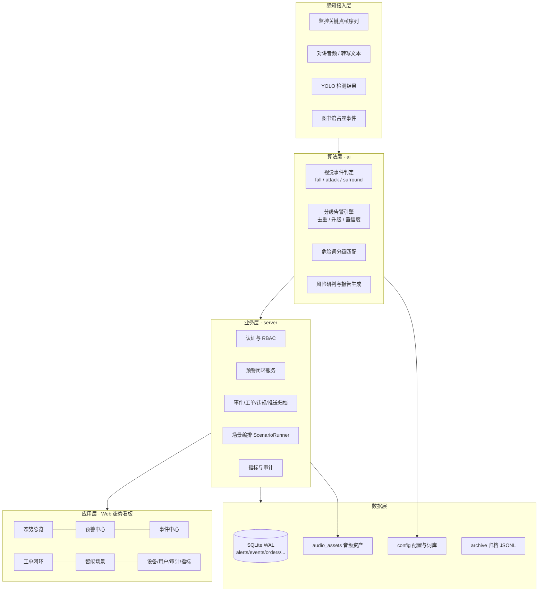
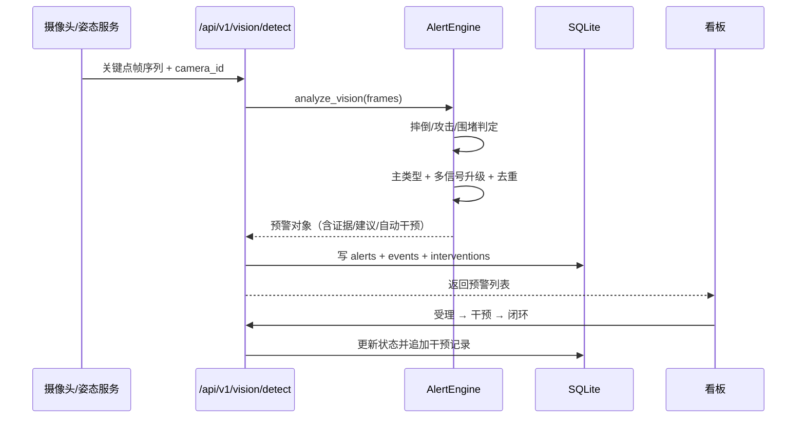
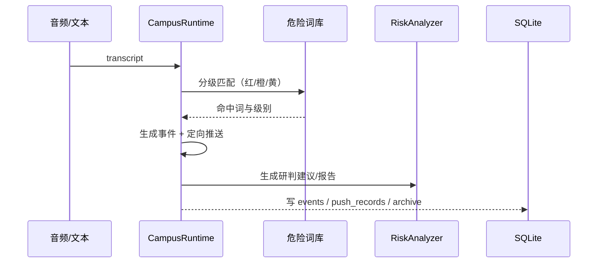
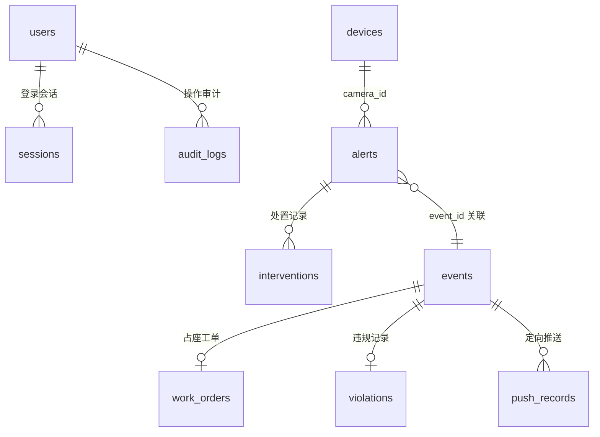

# 02 总体架构设计

---

## 1. 设计原则

| 原则 | 说明 |
| --- | --- |
| 分层解耦 | 感知层、算法层、业务层、应用层、数据层职责单一，层间通过数据结构通信 |
| 标准库优先 | 除 FastAPI / Uvicorn 外不强制第三方依赖，降低学校部署与运维成本 |
| 可插拔降级 | YOLO 权重、ASR、LLM 均为可选增强，缺失时自动使用离线模拟，不阻断主流程 |
| 一事一档 | 预警编号 `ALM-*` 与事件编号 `EVT-*` 贯穿全链路，支持正反向追溯 |
| 安全默认 | 默认拒绝未授权访问，权限点粒度控制，敏感字段按角色脱敏 |

## 2. 分层架构



### 2.1 感知层

| 输入 | 格式 | 来源 |
| --- | --- | --- |
| 姿态关键点帧序列 | `frames: [[{person...}]]`，COCO-17 | 摄像头 + 姿态估计模型 |
| 音频 / 转写文本 | WAV 或文本 | 对讲设备、ASR 服务 |
| 目标检测结果 | `label/conf/bbox/face_ref` | YOLO 行为规范模型 |
| 占座事件 | `seat_id/absent_minutes/items` | `seat_monitor` 独立服务 |

### 2.2 算法层

- `ai/vision/events.py`：纯函数算法，无 I/O、无第三方依赖，可直接单元测试；
- `ai/vision/service.py`：把一帧序列标准化后输出 `VisionSignal` 列表；
- `ai/alert_engine.py`：信号 → 预警，负责主类型选择、升级、去重、置信度、证据与自动干预；
- `ai/audio/`：能量 VAD 与危险词分级匹配；
- `ai/llm/analyzer.py`：规则化处置建议与 Markdown 报告，可选 Ollama 本地增强。

### 2.3 业务层

- `server/api.py`：全部 REST 接口，统一响应 `{"code":0,"data":...}`；
- `server/core/auth.py`：PBKDF2 哈希、会话 Token、RBAC 权限点；
- `server/core/db.py`：连接、建表、种子数据与业务写入；
- `server/core/metrics.py`：线程安全运行指标；
- `server/core/config.py`：默认配置 + `config/app.json` 深合并，路径统一相对项目根目录。

### 2.4 应用层

`web/index.html` 单文件看板：原生 HTML/CSS/JS，纯 SVG 图表，无外网 CDN，
登录后按角色渲染导航，覆盖总览、预警、事件、工单、场景、设备、用户、审计、指标九个页面。

### 2.5 数据层

- SQLite（WAL 模式）存储业务数据，默认路径 `data/campus_security.db`；
- `config/` 存放应用配置与危险词库；
- `audio_assets/` 存放真实语音样本与对应转写文本；
- `archive/` 由 `campus_ai` 运行时写入 JSONL 归档（推送、报告、工单）。

## 3. 关键运行链路

### 3.1 视觉预警链路



### 3.2 多模态研判链路



## 4. 技术栈

| 层 | 技术 | 说明 |
| --- | --- | --- |
| Web 框架 | FastAPI + Uvicorn | 自动 OpenAPI 文档 `/api/docs` |
| 数据库 | SQLite（WAL） | 零部署；表结构可平移 MySQL/PostgreSQL |
| 认证 | PBKDF2-HMAC-SHA256 + Bearer Token | 10 万次迭代，会话 8 小时 |
| 前端 | 原生 HTML/CSS/JS + SVG | 单文件、无 CDN、响应式 |
| 视觉算法 | COCO-17 关键点几何判定 | 零依赖，可测试 |
| 语音 | 能量 VAD + 危险词分级匹配 | 标准库 `array` 实现 |
| 大模型 | 规则化研判 + 可选 Ollama | 异常静默降级 |
| 测试 | pytest + Uvicorn 线程 + urllib | 不依赖 httpx/TestClient |

## 5. 目录与职责

```text
server/          统一后端：API、认证、数据库、指标
ai/              AI 感知与告警：vision、audio、llm、alert_engine
campus_ai/       可复用 AI 业务运行时：agent/intercom/behavior/seat
demo/            演示场景与姿态数据构造
web/             统一态势看板
seat_monitor/    图书馆占座真实摄像头扩展服务
config/          应用配置、危险词库
audio_assets/    真实语音样本与转写
docs/            标准化项目文档
ppt/             PPTX 与 HTML 演示稿
tests/           单元测试与集成测试
```

## 6. 数据模型



核心表：

| 表 | 作用 | 关键字段 |
| --- | --- | --- |
| `users` / `sessions` | 账号与会话 | `password_hash`、`role`、`expires_at` |
| `alerts` | 预警主表 | `alert_id`、`severity`、`status`、`evidence` |
| `interventions` | 干预时间线 | `kind`（voice/dispatch/notify/onsite/close） |
| `events` | 统一事件归档 | `event_type`、`detail` |
| `work_orders` | 占座工单 | `seat_id`、`status` |
| `violations` | 行为规范违规 | `label`、`student_id`、`needs_review` |
| `push_records` | 定向推送 | `targets`、`severity` |
| `devices` | 设备台账 | `dtype`、`location`、`status` |
| `audit_logs` | 审计日志 | `username`、`action` |

## 7. 扩展性与演进

- **新增识别类型**：在 `ai/vision/events.py` 增加判定函数，在 `ai/alert_engine.py` 注册类型、基础级别与标签即可；
- **新增业务场景**：实现 `CampusRuntime` 中对应 `handle_*`，并在 `demo/scenarios.py` 注册场景；
- **替换视觉模型**：保持帧序列输入契约不变，可替换为 YOLO-Pose、RTMPose 等；
- **生产数据库**：将 `server/core/db.py` 的连接层替换为 SQLAlchemy/psycopg，表结构与 SQL 基本兼容；
- **多校区部署**：看板与 API 前后端分离后可直接水平扩展，SQLite 换成集中式数据库。
