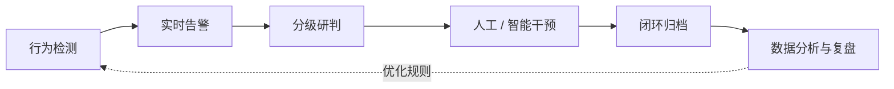
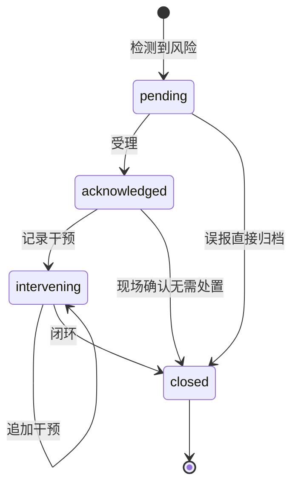
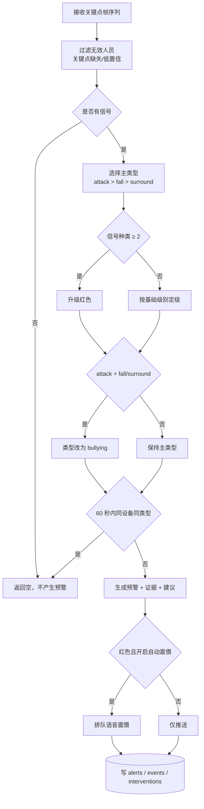
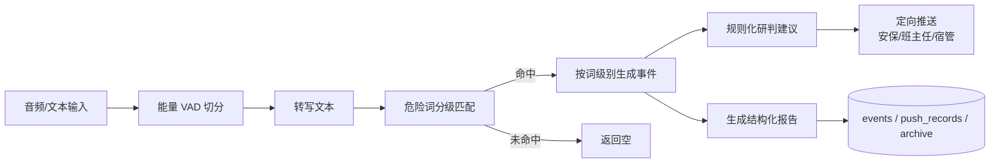
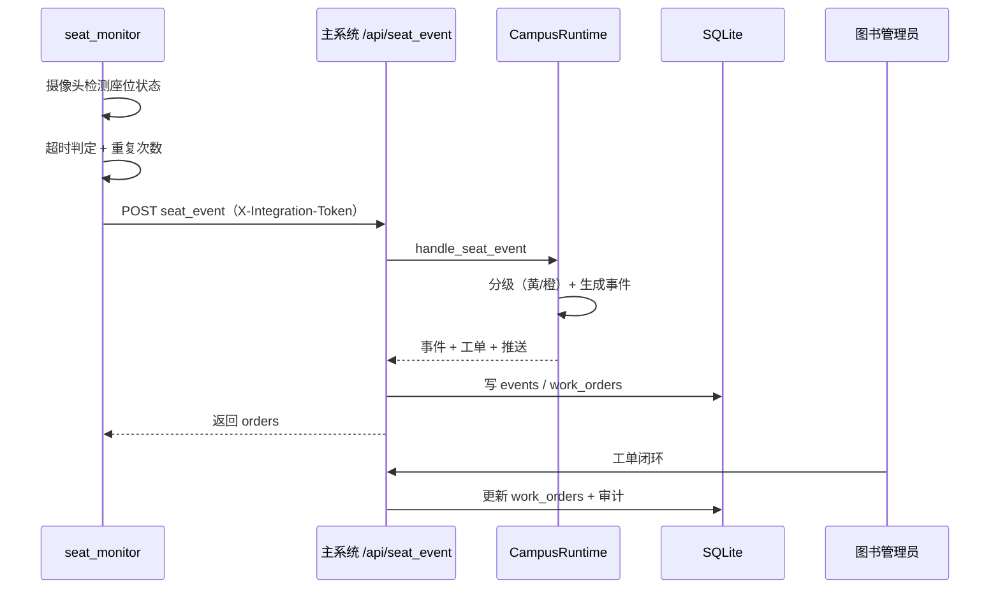
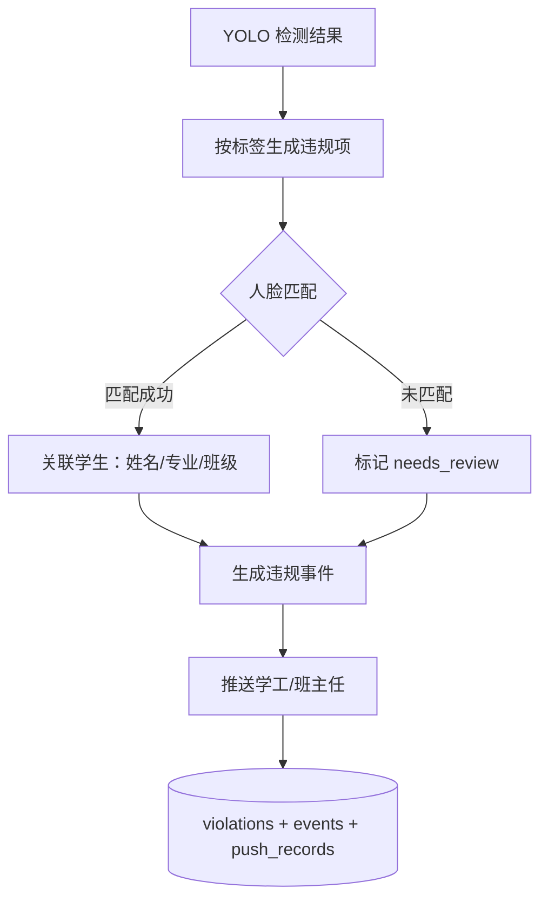

# 04 业务流程与闭环设计

---

## 1. 总体业务闭环

| 阶段 | 关键动作 | 系统承载 |
| --- | --- | --- |
| 行为检测 | 姿态关键点分析、危险词匹配、YOLO 检测 | `ai/vision`、`ai/audio`、`campus_ai/behavior_service` |
| 实时告警 | 生成预警编号、定级、去重、推送 | `ai/alert_engine.py`、`server/api.py` |
| 分级研判 | 多信号叠加、处置建议、可选 LLM 深判 | `ai/llm/analyzer.py` |
| 干预处置 | 语音震慑、安保调度、班主任通知、现场处置 | 预警闭环 API、`interventions` 表 |
| 闭环归档 | 状态置为 closed、写审计、生成报告 | `alerts`、`events`、`audit_logs` |
| 分析复盘 | 趋势、级别分布、类型分布、运行指标 | `/api/v1/overview`、`/api/v1/metrics` |

## 2. 预警状态机

状态含义：

| 状态 | 含义 | 允许操作 |
| --- | --- | --- |
| `pending` | 待受理 | 受理、记录干预、闭环 |
| `acknowledged` | 已受理 | 记录干预、闭环 |
| `intervening` | 干预中 | 追加干预、闭环 |
| `closed` | 已闭环 | 只读，不可继续干预 |

约束：

- 受理仅允许 `pending → acknowledged`；
- 已闭环预警再次干预返回业务错误；
- 每次状态变化同时写入 `interventions` 与 `audit_logs`。

## 3. 视觉预警详细流程

关键规则：

1. **去重键**：`(camera_id, alert_type)`，窗口默认 60 秒，可通过 `vision.dedupe_seconds` 调整；
2. **强制模式**：`force=true` 时跳过去重，用于演示与联调；
3. **自动震慑**：`alert.auto_deterrence_red=true` 时，红色预警自动产生 `voice` 干预，内容为固定警告话术；
4. **事件关联**：每条预警预生成 `event_id`，先于预警写入事件表，保证追溯链完整。

## 4. 多模态研判流程

危险词分级：

| 级别 | 示例 | 处置 |
| --- | --- | --- |
| 红 | 救命、打死、流血 | 立即告警 + 语音震慑 + 领导通知 |
| 橙 | 别打我、滚开、住手 | 告警 + 值班员到场 |
| 黄 | 威胁性语言、辱骂 | 记录 + 班主任关注 |

## 5. 图书馆占座扩展流程

分级规则：

- 首次超时且 25–30 分钟：黄色；
- 重复占座或超时更久：橙色，摘要标注「第 N 次」；
- 集成令牌校验失败返回 `403 / 40300`。

## 6. 行为规范违规流程

未识别人员不阻断流程，而是转人工复核，避免因人脸库缺失造成漏记。

## 7. 事件编号与追溯

| 编号 | 格式 | 生成位置 |
| --- | --- | --- |
| 预警编号 | `ALM-YYYYMMDD-xxxxxxxx` | `ai/alert_engine.py: new_alert_id` |
| 事件编号 | `EVT-YYYYMMDD-xxxxxxxx` | `ai/alert_engine.py: new_event_id` |

追溯路径：

- 预警 → 事件：`alerts.event_id`；
- 事件 → 工单/违规/推送：`work_orders.event_id`、`violations.event_id`、`push_records.event_id`；
- 操作 → 审计：`audit_logs.detail` 记录 `alert_id` 或 `event_id`。

## 8. 异常与边界处理

| 场景 | 处理方式 |
| --- | --- |
| 帧序列为空 | 接口返回 `400 / 40000`，提示 `frames 不能为空` |
| 关键点缺失或低置信 | 该人员被过滤，不参与判定 |
| 非法干预类型 | 返回 `400 / 40000`，仅允许 voice/dispatch/notify/onsite |
| 重复受理 | 返回 `404 / 40400`，提示不存在或已被受理 |
| 已闭环再干预 | 返回 `400 / 40000`，提示已闭环 |
| 占座令牌错误 | 返回 `403 / 40300`，集成令牌无效 |
| 场景不存在 | 返回 `404 / 40400`，未知场景 |
| 运行时不可用 | 占座与词库热更新返回 `400 / 40000`，不影响视觉主流程 |

## 9. 处置时效建议（运维口径）

| 级别 | 建议响应时限 | 建议动作 |
| --- | --- | --- |
| 红色 | 立即 | 语音震慑 + 安保到场 + 值班领导通知 |
| 橙色 | 5 分钟内 | 值班员到场核实 + 班主任通知 |
| 黄色 | 15 分钟内 | 值班员查看画面 + 记录 |
| 蓝色 | 当日 | 归档观察，纳入趋势分析 |
