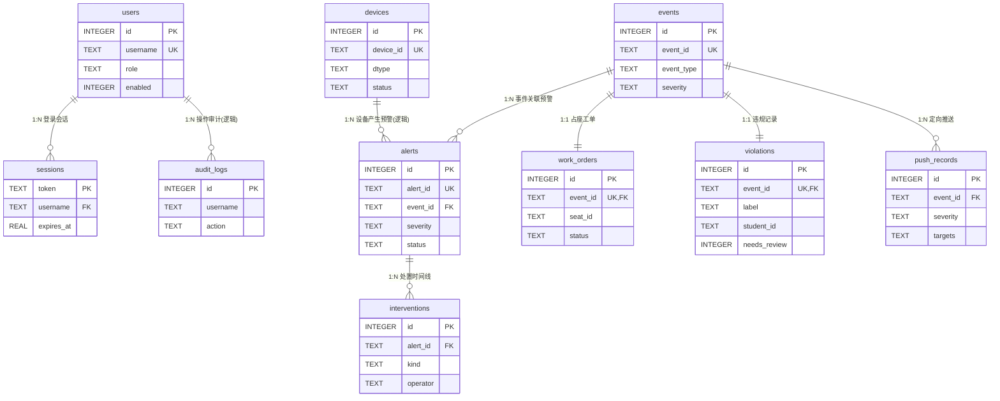

# 06 数据库设计说明书

> 数智卫校 · 校园安全 AI 预警与干预系统 · 正式数据库设计 v2.0  
> 配套脚本：[server/sql/schema_v2.sql](../server/sql/schema_v2.sql)（已验证可直接执行）  
> 与 docs/03《数据库设计与运维》的关系：03 记录轻量方案的评估与运维过程；本文档是按正式设计流程（需求 → 概念模型 → 物理设计 → 索引 → 审计 → 脚本 → 评审）产出的 v2.0 设计规范，作为运行版 `schema.sql` 的演进目标与参赛评审依据。

---

## 1. 业务需求梳理（概念模型输入）

### 1.1 核心业务实体

| 实体 | 业务含义 | 必要属性 | 业务约束 |
| --- | --- | --- | --- |
| 用户 users | 系统账号（RBAC） | 登录名、密码哈希、姓名、角色、启用标识 | 登录名唯一；角色限定五类；停用账号不可登录 |
| 会话 sessions | 登录态令牌 | 令牌、用户名、角色快照、签发/过期时间 | 令牌唯一；过期即失效 |
| 设备 devices | 摄像头/对讲/告警器台账 | 设备编号、类型、位置、状态 | 设备编号唯一 |
| 事件 events | 统一事件归档（一事一档锚点） | 事件编号、类型、级别、来源、地点、摘要、明细 | 事件编号唯一；先于预警写入 |
| 预警 alerts | 核心预警工单 | 预警编号、关联事件、类型、级别、置信度、设备、证据、状态、发生时间、受理/闭环信息 | 预警编号唯一；状态机 pending→acknowledged→intervening→closed |
| 干预 interventions | 预警处置时间线 | 关联预警、处置类型、操作人、内容、时间 | 必须依附存在的预警 |
| 工单 work_orders | 图书馆占座工单 | 关联事件、座位、区域、状态、闭环信息 | 与事件 1:1 |
| 违规 violations | 行为规范违规记录 | 关联事件、违规类型、置信度、学生信息快照、待复核标识 | 与事件 1:1；人脸未匹配须标记复核 |
| 推送 push_records | 定向推送留痕 | 关联事件、级别、目标角色、摘要 | 必须依附存在的事件 |
| 审计 audit_logs | 操作审计 | 操作人、动作、明细、时间 | 追加式，不可修改 |

### 1.2 实体关联关系

| 关系 | 基数 | 说明 |
| --- | --- | --- |
| 用户 — 会话 | 1 : N | 一个用户可有多个活跃会话 |
| 用户 — 审计日志 | 1 : N（逻辑） | 离职/删除用户的日志须保留，不强制外键 |
| 设备 — 预警 | 1 : N（逻辑） | `alerts.camera_id` 引用 `devices.device_id`，不强制外键（见 4.3） |
| 事件 — 预警 | 1 : N | 一个事件可产生多条预警（去重后通常 1:1） |
| 预警 — 干预 | 1 : N | 一条预警有完整处置时间线 |
| 事件 — 工单 | 1 : 1 | 占座事件对应唯一工单 |
| 事件 — 违规 | 1 : 1 | 违规事件对应唯一违规记录 |
| 事件 — 推送 | 1 : N | 一个事件可定向推送多个角色 |

## 2. 概念模型（ER 图）

### 2.1 第三范式论证

| 检查项 | 结论 |
| --- | --- |
| 1NF（原子性） | 满足。`targets`、`evidence`、`detail` 为 JSON 文档字段，属有意反范式（见 2.2 决策 1）；其余字段均原子 |
| 2NF（非主属性完全依赖主键） | 满足。全部表使用无业务含义的自增主键或业务唯一键，无部分依赖 |
| 3NF（无传递依赖） | 满足。唯一例外是 `violations` 的学生姓名/专业/班级——为外部人脸系统的**快照字段**，学生主数据权威源在校方系统，本地不建学生表（见 2.2 决策 2） |

### 2.2 关键设计决策

1. **JSON 文档字段**（`alerts.evidence`、`events.detail`、`push_records.targets`）：证据与明细结构随算法演进频繁变化，强结构化会导致频繁改表；查询均不按 JSON 内部字段过滤，故以文档列存储，换取 schema 稳定性。
2. **学生信息快照**：违规记录留存识别时刻的姓名/专业/班级快照，避免与外部人脸库强耦合，同时保证历史事件在学生转学/改名后仍可追溯。
3. **alerts.summary ↔ events.summary 有意冗余**：预警列表与事件列表查询免关联，写入端同源生成（docs/03 已评审记录为 noted 项）。

## 3. 物理表结构设计

数据库类型：SQLite 3（WAL）。类型映射：`TEXT→VARCHAR`、`INTEGER→INT/BIGINT`、`REAL→DOUBLE`，可直接平移 MySQL/PostgreSQL（审计触发器需改写为对应方言）。

| 表 | 主键 | 业务唯一约束 | 外键 | 字段数（含审计） |
| --- | --- | --- | --- | --- |
| users | id 自增 | username | — | 10 |
| sessions | token | — | username → users.username | 5 |
| devices | id 自增 | device_id | — | 10 |
| events | id 自增 | event_id | — | 12 |
| alerts | id 自增 | alert_id | event_id → events.event_id | 21 |
| interventions | id 自增 | — | alert_id → alerts.alert_id | 7 |
| work_orders | id 自增 | event_id | event_id → events.event_id | 11 |
| violations | id 自增 | event_id | event_id → events.event_id | 14 |
| push_records | id 自增 | — | event_id → events.event_id | 10 |
| audit_logs | id 自增 | — | —（逻辑关联 users） | 5 |

逐表字段定义（类型、空值、默认值、含义）以 [schema_v2.sql](../server/sql/schema_v2.sql) 行内注释为准，要点：

- 全部业务表 `id INTEGER PRIMARY KEY AUTOINCREMENT` 自增主键；
- 业务编号（alert_id / event_id / username / device_id）均 `NOT NULL UNIQUE`；
- 枚举语义字段（role / severity / status / dtype 等）以 TEXT + 应用层校验，SQLite 不设 CHECK 以保持演示数据写入灵活性；
- 时间统一 `REAL`（Unix 秒）；可空处置字段（ack_by/ack_at/closed_by/closed_at）允许 NULL，表示未发生。

## 4. 索引设计

### 4.1 索引清单（16 个普通/联合索引 + 6 个唯一约束自动索引）

| 索引 | 类型 | 服务的高频查询 | 设计理由 |
| --- | --- | --- | --- |
| idx_alerts_status_time (status, occurred_at) | 联合 | 预警中心默认列表（按状态过滤+时间倒序） | 最高频查询，替代原单列 status 索引 |
| idx_alerts_severity | 普通 | 级别筛选、红色未闭环指标 | 低基数但选择性强（红色少） |
| idx_alerts_type | 普通 | 类型分布统计 | 中频聚合 |
| idx_alerts_event | 普通 | 外键回查事件 | FK 配套，避免回表扫 |
| idx_alerts_camera | 普通 | 设备卡片今日预警 | 设备维度筛选 |
| idx_events_type_created (event_type, created_at) | 联合 | 事件中心按类型+时间筛选 | 高频 |
| idx_events_severity | 普通 | 级别分布 | 中频 |
| idx_events_created | 普通 | 24 小时趋势聚合 | 纯时间范围扫描（联合索引左缀不覆盖） |
| idx_interventions_alert | 普通 | 预警详情处置时间线 | FK 配套 |
| idx_orders_status_time (status, created_at) | 联合 | 工单闭环页待处理置顶 | 高频 |
| idx_violations_student | 普通 | 按学号追溯违规 | 中频 |
| idx_violations_review (needs_review, created_at) | 联合 | 人工复核队列 | 中频 |
| idx_push_event | 普通 | 事件推送回查 | FK 配套 |
| idx_sessions_expires | 普通 | 过期会话清理 | 定时任务 |
| idx_audit_created | 普通 | 审计页时间倒序 | 高频 |
| idx_audit_user_time (username, created_at) | 联合 | 按操作人追溯 | 中频 |

### 4.2 索引数量控制

- 预警/事件两张热表各 5/3 个索引，写入放大可控（SQLite 单写者，批量写入场景少）；
- **有意不建**：`devices`（全表 <千行，全扫成本可忽略）、`sessions.username`（会话只按 token 主键访问）、`alerts.deleted`（低选择性，配合 status 联合索引足够）；
- 唯一约束（username/alert_id/event_id/device_id/work_orders.event_id/violations.event_id）由 SQLite 自动建唯一索引，同时承担去重与回查职责。

## 5. 审计字段与变更可追溯

| 字段 | 覆盖表 | 维护方式 |
| --- | --- | --- |
| created_at | 全部 10 表 | 应用层写入 |
| updated_at | users/devices/events/alerts/work_orders/violations/push_records | **AFTER UPDATE 触发器自动刷新**（7 个 `trg_*_touch`） |
| created_by / updated_by | 同上 7 张业务表 | 应用层写入，默认 `system` |
| deleted | 同上 7 张业务表 | 逻辑删除标识 0/1，查询层默认过滤 |

例外说明：`sessions`（临时凭证）、`interventions` / `audit_logs`（追加式留痕，本身即审计载体）不挂通用审计字段——干预记录已有 `operator`，审计日志本身不可修改。

## 6. 建表脚本与验证

脚本：[server/sql/schema_v2.sql](../server/sql/schema_v2.sql)，SQLite 语法，含表/字段行内注释、执行顺序即依赖顺序。

自动化验证结果（临时库实测，全部通过）：

| 验证项 | 结果 |
| --- | --- |
| 脚本直接执行 | 通过（10 表 + 16 索引 + 7 触发器） |
| 正常外键链插入（user→session，event→alert→intervention，event→工单/违规/推送） | 通过 |
| 孤儿预警（无对应事件）插入 | 被外键拦截（IntegrityError） |
| 重复 alert_id 插入 | 被唯一约束拦截 |
| UPDATE 后 updated_at 触发器刷新 | 通过 |
| `PRAGMA integrity_check` | ok |

> 注意：外键生效需连接时 `PRAGMA foreign_keys = ON`，运行版 `server/core/db.py` 已内置该设置。

## 7. 设计评审结论

| 评审项 | 结论 |
| --- | --- |
| 业务覆盖 | 10 个实体完整覆盖预警闭环、事件归档、占座工单、违规记录、推送、设备、权限、审计八类业务需求 |
| 范式合规 | 满足 3NF；3 处有意的反范式/快照设计均已论证并记录（2.2 节） |
| 外键完整性 | 事件链（events→alerts→interventions，events→工单/违规/推送）全部强制；2 处逻辑外键（camera_id、audit username）有意不强制并注明理由 |
| 索引合理性 | 16 个索引均有明确查询场景；热表写入放大可控；低选择性/小表场景有意不建索引 |
| 审计可追溯 | 5 类审计字段 + 触发器自动维护 + 逻辑删除，满足变更轨迹可追溯 |
| 可迁移性 | 类型与约束可平移 MySQL/PostgreSQL；触发器需按目标库方言改写 |
| 性能风险 | 无全表扫描热点；万级预警数据量下主要查询均命中索引 |

**评审结论：设计通过，可作为参赛正式设计与运行版 schema 的演进目标。**

### 7.1 落地路径

1. 本期运行版继续使用 `server/sql/schema.sql`（应用层一致性校验），v2 脚本作为正式设计交付与评审物；
2. 迁移时由 `scripts/db_setup.py` 切换指向 `schema_v2.sql`，并同步改造写入层填充 created_by/updated_by；
3. 迁移后沿用 `scripts/db_check.py` 做全量复核（结构/性能/安全/一致性/备份/接口六项）。
