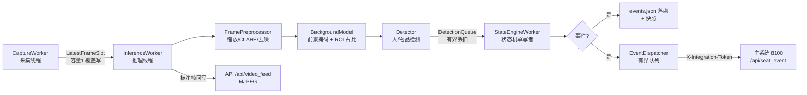
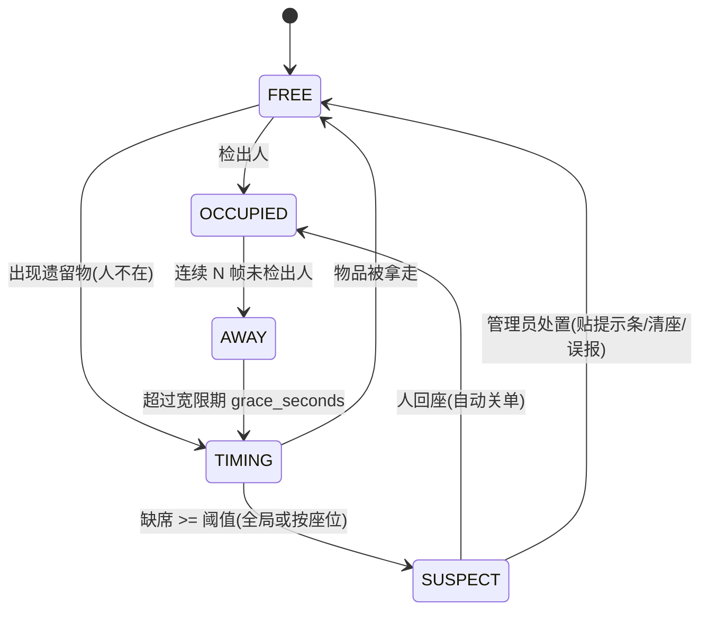

# 09 占座嫌疑识别功能实现方案

> 图书馆占座监测（seat_monitor）· 基于视频采集的占座嫌疑识别  
> 版本 v0.3.0 · 与主系统通过 `/api/seat_event` + 集成令牌对接

---

## 1. 功能目标与边界

| 目标 | 说明 |
| --- | --- |
| 视频接入 | 本地摄像头 / RTSP / 视频文件，断流自动重连，采集永不阻塞推理 |
| 占座识别 | 背景建模 → 目标检测 → 人/遗留物品分类 → 区域占用判定 → 停留时长统计 → 嫌疑事件 |
| 阈值配置 | 全局阈值 + 按座位覆盖，在线热更新，立即生效 |
| 状态同步 | 事件本地落盘（events.json）+ 推送主系统生成工单 + 前端实时轮询展示 |
| 演示前端 | 实时视频预览 / 区域状态面板 / 嫌疑告警列表 / 历史记录查询 四模块 |
| 兼容约束 | 不修改主系统任何接口契约；seat_monitor 可独立启停，不影响主系统运行 |

## 2. 技术选型说明

| 环节 | 选型 | 理由 |
| --- | --- | --- |
| 视频采集 | OpenCV `VideoCapture`（惰性导入） | 摄像头/RTSP/文件统一接口；缺失时服务可启动并给出中文降级提示 |
| 帧传递 | 容量 1 的「最新帧邮箱」 | 采集永不阻塞推理，积压自动丢旧帧，天然背压 |
| 预处理 | OpenCV resize + CLAHE（LAB L 通道） | 逆光/昏暗场景下稳定检测；无 cv2 时直通降级 |
| 背景建模 | MOG2 优先，numpy 运行均值+帧差兜底 | MOG2 自适应光照缓变；无 cv2 时零依赖可运行、可测试 |
| 目标检测 | YOLO26 pose（人+关键点）/ YOLO26n（物品，COCO） | 单模型同时出人框与关键点；权重缺失三级降级不中断 |
| 状态判定 | 纯 Python 状态机（单写者线程） | 逻辑透明、可单测、无锁竞争 |
| 前端 | 原生 HTML/JS + MJPEG `` | 零构建、离线可用；MJPEG 对浏览器零依赖 |
| 数据同步 | REST 推送 + 本地 JSON 落盘 | 主系统不可用时本地留痕，恢复后工单仍可闭环 |

**算法选型对比**（背景建模）：

| 方案 | 光照鲁棒性 | 遗留物检出 | 依赖 | 结论 |
| --- | --- | --- | --- | --- |
| 帧差法（相邻帧） | 差 | 只能检运动 | 无 | 遗留物静止后漏检，弃用为主方案 |
| 运行均值背景 + 帧差 | 中 | 好（慢速吸收） | numpy | 兜底方案，测试可用 |
| MOG2 混合高斯 | 好（自适应缓变） | 好 | opencv | 首选 |
| YOLO 物品检测 | 不受光照影响（相对） | 仅限训练类别 | torch | 与背景建模互补：检测器负责"分类"，背景负责"有东西" |

## 3. 视频流处理流程



关键设计：

- **采集稳定性**：断流指数退避重连（2s→30s 封顶），文件源自动循环播放，全部异常记录到 `health()`；
- **预处理坐标系唯一**：缩放后帧是唯一推理输入，检测框、ROI 命中、标注帧、快照同坐标系，避免错位（ROI 为归一化多边形，与分辨率解耦）；
- **降级链**：检测器 `pose → fallback → degraded`，预处理 `cv2 → 直通`，背景 `mog2 → framediff → 关闭`，任一环节缺失都不中断服务。

## 4. 识别逻辑与状态判定

### 4.1 证据来源

| 证据 | 来源 | 用途 |
| --- | --- | --- |
| 人在座 | 上半身关键点/人框上半段落点命中 ROI | 占用判定 |
| 物品在座 | 物品框底边中心命中 ROI（背包/手提包/书本/水杯等 7 类） | 遗留判定 |
| 静态遗留物 | 背景建模：ROI 前景占比 ≥ `occupied_ratio` 且窗口内波动 ≤ `static_stability` | 补充"物品在"证据（覆盖训练集外物品，如衣物） |

### 4.2 座位状态机



防抖与防误报：

- `absent_confirm_frames`：连续 N 次检测无人才确认离开，单帧漏检不误判；
- `grace_seconds`：暂离宽限期（默认 180s），取书/上厕所不计嫌疑；
- `SUSPECT` 不重复生成事件，仅更新持续时长；当日再次触发 `repeat_count+1`；
- 人回座且事件待处理 → 自动关单「已自动关闭(人已回座)」。

### 4.3 增强判定

- **一人多座**：邻座 ROI 中心距 < 1.5 倍本座尺度且邻座有人 → 事件标记 `multi_seat`；
- **预约偏差**：事件时刻座位在预约时段内但人不在 → 附带预约卡号尾号；
- **背景辅助**：`assist_items=true` 时，静态遗留物折算为 `遗留物(背景)` 物品参与计时；
  仅补充"物"证据，永不参与"人"判定，避免把人静坐误判为空位。

## 5. 阈值与配置

`settings.json`（全部支持 `POST /api/settings` / `POST /api/seat_thresholds` 热更新）：

| 配置 | 默认 | 说明 |
| --- | --- | --- |
| `absent_threshold_minutes` | 25 | 全局占座判定阈值（分钟） |
| `seat_thresholds` | `{}` | 按座位覆盖，如 `{"A01": 15}` |
| `grace_seconds` | 180 | 暂离宽限期 |
| `absent_confirm_frames` | 3 | 离开确认帧数 |
| `detect_interval_sec` | 1.0 | 检测频率 |
| `preprocess.resize_width` | 960 | 预处理缩放宽度 |
| `preprocess.clahe` | true | 光照均衡 |
| `background.occupied_ratio` | 0.10 | ROI 前景占比阈值 |
| `background.static_window_sec` | 30 | 静态遗留物观察窗 |
| `background.static_stability` | 0.05 | 占比波动容忍 |
| `background.assist_items` | true | 遗留物辅助判定开关 |

## 6. 前后端数据交互

### 6.1 监测服务 API（默认 8200）

| 方法 | 路径 | 说明 |
| --- | --- | --- |
| GET | `/api/state` | 全部座位实时状态（含 `bg_ratio` / `bg_static`）+ 流水线健康 |
| GET | `/api/video_feed?annotated=1` | MJPEG 实时流（前端 `` 直连） |
| GET | `/api/snapshot.jpg` | 当前帧快照 |
| GET | `/api/events` | 历史记录查询：`seat_id` / `status` / `q` / `date` 过滤 + 分页 |
| POST | `/api/events/{id}/resolve` | 处置：贴提示条 / 清座 / 误报 |
| GET/POST | `/api/seat_thresholds` | 全局/按座位阈值读写 |
| GET/POST | `/api/settings` | 配置读写（热更新） |
| GET | `/api/background` | 背景建模状态与每座位前景占比 |
| GET/POST | `/api/rois` | 座位 ROI 标定（归一化多边形） |

### 6.2 前端四大模块（seat_monitor/web/index.html）

| 模块 | 数据源 | 刷新 |
| --- | --- | --- |
| 实时视频流预览 | `/api/video_feed` MJPEG | 浏览器原生流 |
| 区域状态可视化面板 | `/api/state` | 1s 轮询 |
| 占座嫌疑告警列表 | `/api/events`（待处理置顶，可处置） | 3s 轮询 |
| 历史识别记录查询 | `/api/events?过滤条件` | 手动查询 + 3s 轮询 |

前端与主系统看板完全隔离（独立端口、独立静态目录），仅通过事件推送产生业务关联。

### 6.3 与主系统对接

```text
seat_monitor → POST http://127.0.0.1:8100/api/seat_event
             （X-Integration-Token 与 config/app.json 的 app.integration_token 一致）
             → 主系统生成事件 + 占座工单 → 看板「工单闭环」处置
```

推送失败不重试、不阻塞（有界队列 + 本地 events.json 兜底）；主系统恢复后管理员仍可在看板闭环。

## 7. 异常场景处理策略

| 场景 | 策略 |
| --- | --- |
| 摄像头被占用/拔出 | 指数退避重连（2s→30s），错误入 `health()`，前端芯片提示 |
| 未安装 opencv | 预处理直通、背景降级 framediff、快照接口返回降级提示 |
| 未安装 ultralytics / 权重损坏 | 检测器三级降级，返回空结果，状态机照常运行 |
| 推理单帧异常 | 内化记录，丢弃该帧，线程不退出 |
| 主系统宕机 | 事件本地落盘 + 推送队列丢弃计数，恢复后人工在看板处理 |
| 光照突变（开关灯） | CLAHE 均衡 + MOG2 自适应；framediff 下差阈值可调 |
| 人长时间静坐 | 关键点/人框持续命中 ROI 判定在座；背景证据不参与"人"判定 |
| 队列积压 | 帧邮箱容量 1、检测队列丢旧、推送队列有界——全链路无阻塞点 |

## 8. 实现优先级与分步路径

| 优先级 | 模块 | 状态 |
| --- | --- | --- |
| P0 | 采集线程（重连/邮箱） | 已完成（原有） |
| P0 | 状态机与事件生成 | 已完成（原有） |
| P0 | 主系统事件对接与工单闭环 | 已完成（原有） |
| P1 | 帧预处理（缩放/CLAHE/去噪） | 本次新增 `preprocess.py` |
| P1 | 背景建模 + 静态遗留物辅助判定 | 本次新增 `background.py` + 状态机融合 |
| P1 | 四模块演示前端 | 本次新增 `seat_monitor/web/index.html` |
| P1 | 事件过滤查询与背景状态 API | 本次增强 `api.py` |
| P2 | 前端 ROI 可视化标定 | 后续（当前通过 API 标定） |
| P2 | 多摄像头多流水线并行 | 后续（单流水线对象可复制） |
| P3 | 遗留物图像分类二次确认 | 后续（接入校内小模型） |

## 9. 测试验证

### 9.1 自动化测试（tests/test_seat_video.py，15 项）

| 类别 | 用例 | 结论 |
| --- | --- | --- |
| 采集稳定性 | 连续 30+ 帧无中断、邮箱覆盖、断流指数退避恢复 | 通过 |
| 帧预处理 | 缩放尺寸、关闭缩放直通、空帧安全、无 cv2 降级 | 通过 |
| 背景建模 | 背景学习后前景占比 ≥0.5、静态遗留物判定/消失复位、禁用与异常安全 | 通过 |
| 状态机融合 | 静态遗留物驱动 FREE→TIMING→SUSPECT（事件含 bg_ratio）、assist 关闭不影响、多光照（暗/常/强）判定一致 | 通过 |
| API 联调 | /api/state、/api/background、阈值读写、事件过滤（座位/状态/日期/关键词）、处置闭环、非法动作 400 | 通过 |

全量回归：**78 passed + 1 skipped**（无 cv2 环境的快照编码用例按设计跳过）。

### 9.2 真机验证步骤（部署时执行）

```bash
pip install torch ultralytics opencv-python   # 完整视觉能力
python -m seat_monitor.main                   # 默认读 settings.json，端口 8200
```

1. **摄像头稳定性**：打开 `http://127.0.0.1:8200`，观察「流水线」芯片为"全部运行"，
   拔插摄像头一次，确认自动重连且「视频源」芯片恢复；
2. **识别准确率**：
   - 正常光照：人员落座 → 区域卡片显示"在座"；放置背包离开 → 宽限期后进入"离开计时中"；
   - 昏暗/逆光：开启 `preprocess.clahe` 重复上述，确认判定一致；
   - 遗留物：人离开且背包留下 → 超过阈值产生"疑似占座"告警；
   - 误报场景：人短暂经过（< `absent_confirm_frames` 帧）不产生计时；
3. **前端可用性**：四模块渲染正常，告警处置按钮（贴提示条/清座/误报）状态即时刷新，
   历史记录按座位/日期/关键词过滤正确，主系统「工单闭环」同步出现工单。

## 10. 交付物清单

| 交付物 | 位置 |
| --- | --- |
| 帧预处理模块 | `seat_monitor/preprocess.py` |
| 背景建模模块 | `seat_monitor/background.py` |
| 推理线程（接入预处理/背景信号） | `seat_monitor/inference.py` |
| 状态机（遗留物辅助判定） | `seat_monitor/seat_state.py` |
| 监测 API（过滤/背景状态/独立前端挂载） | `seat_monitor/api.py` |
| 演示前端（四模块单文件页） | `seat_monitor/web/index.html` |
| 配置（预处理/背景建模） | `settings.json`、`seat_monitor/config.py` |
| 自动化测试 | `tests/test_seat_video.py` |
| 本方案文档 | `docs/09_占座监测功能实现方案.md` |
